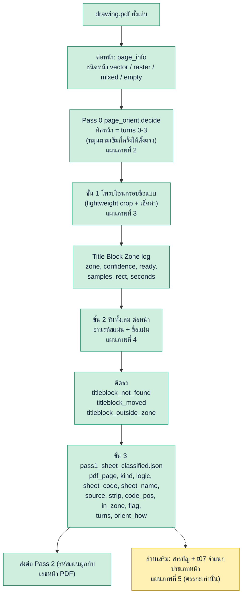
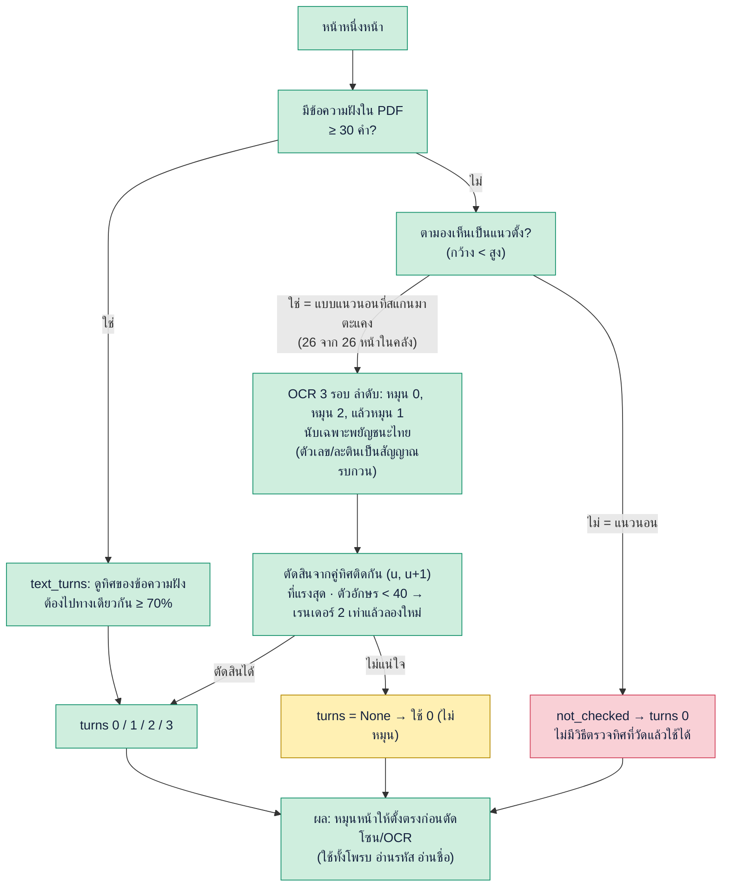
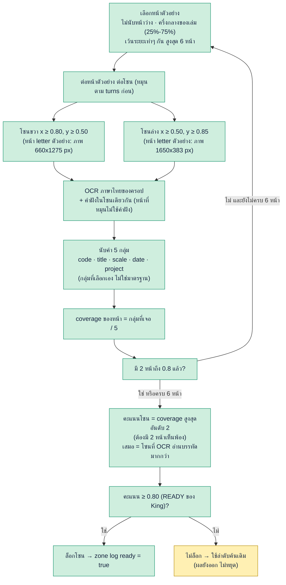
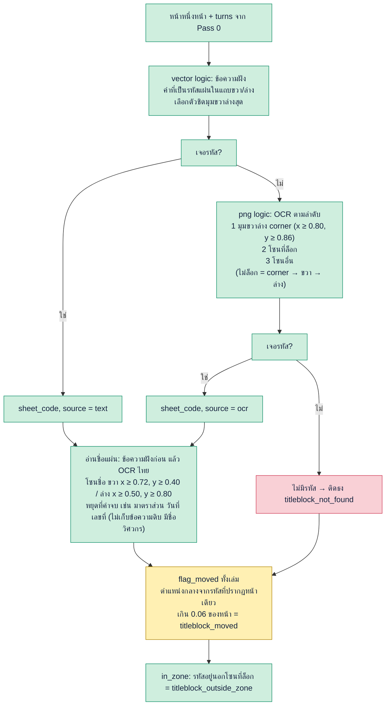
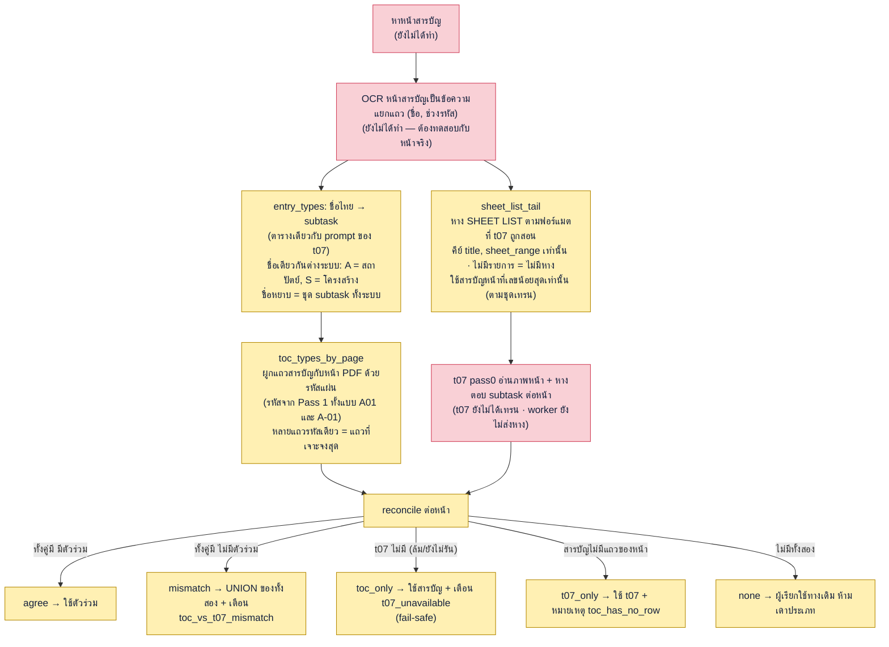
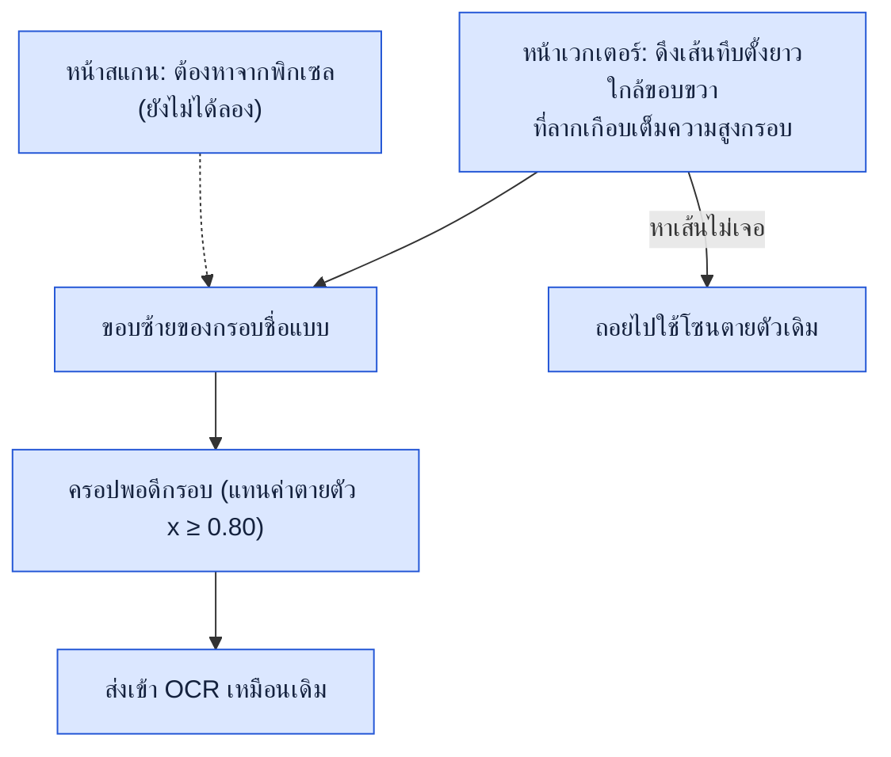

# Pass 1 — จำแนกหน้า / รหัสแผ่น / ชื่อแผ่น (+ ทิศหน้า Pass 0 + สารบัญ↔t07)

สถานะ 21 พ.ย. 2569 · โค้ด: `tools/page_orient.py` (Pass 0) · `tools/pass1_sheet_classify.py` · `tools/titleblock_extract.py` · `tools/pass1_toc.py` (ตรรกะสารบัญ)
สี: 🟩 ทำแล้วและวัดแล้ว · 🟨 ทำบางส่วน/ตรรกะเท่านั้น · 🟥 ยังไม่ได้ทำ · 🟦 ข้อเสนอ (ยังไม่ได้ลงมือ)

## แผนภาพที่ 1 ภาพรวม

## แผนภาพที่ 2 Pass 0: ทิศหน้ากระดาษ (`page_orient.py`)

ผลที่วัด: หน้าเวกเตอร์ที่ข้อความตะแคง 953 หน้าใน 35 เล่ม ทุกหน้าต้องหมุน 3 ครั้ง (ไม่มีทิศอื่นปน) · หน้าสแกนตะแคง 26 หน้า ตัดสินได้ 25 (ตรวจด้วยตา 3, ที่เหลือตรวจแค่ความสม่ำเสมอ) · ตัวจำแนกทิศสำเร็จรูป (PP-LCNet) ผิดราว 94% บนหน้าแนวนอน ใช้ไม่ได้ · **ไม่ได้ตรวจ:** หน้าสแกนแนวนอนที่เนื้อหาตะแคงข้างใน

## แผนภาพที่ 3 ขั้น 1: โพรบโซน (lightweight title block crop)

ผลที่วัด (บางส่วน · กฎสุ่มหน้ารอบแรก): 15 เล่มบ้านเล็ก 1 ชั้น (เลือกทุกเล่มที่ 5): หน้าที่เฉลยมีรหัส 205 หน้า ถูก 183 · ไม่เจอ 22 (อยู่ใน `1ชั้น_06` ทั้งหมด) · **ผิด 0** · ล็อกโซน 13 เล่ม ไม่ล็อก 2 เล่ม · `174` โซนล่าง คะแนน 1.0 รหัส S-07..S-11 5/5 · โพรบ 33.2 วินาที รันทั้ง 5 หน้า 138.6 วินาที
**ข้อจำกัด:** โพรบมองไม่เห็นเล่มที่หน้ากลางเล่มส่วนใหญ่เป็น BOQ (`1ชั้น_06` ได้ 0.2 ไม่ล็อก) · ยังไม่ได้เทียบความเร็วกับตัวอ่านเดิม · "lightweight" ของ King อาจหมายอย่างอื่น (เช่น หาตำแหน่งกรอบจากความหนาเส้น) ยังไม่ได้ถาม · ทดลองความหนาเส้นกับ `1ชั้น_27` 6 หน้า ชี้กรอบไม่ได้ (กรอบพล็อตที่ความหนาเดียวกับเส้นทั่วไป)

## แผนภาพที่ 4 ขั้น 2: อ่านรหัสแผ่นและชื่อแผ่นต่อหน้า

ผลที่วัด: `titleblock_extract.py` รหัสแผ่นถูก 475/475 บนหน้าที่เฉลยเป็นรหัสแบบตัวอักษร+เลข (ตัวอย่าง 33 เล่ม) · หน้าสแกนตะแคง `เป็นสุข2` หน้า 5: ก่อนหมุนอ่านได้ A-05 (ผิด จากสัญลักษณ์ในวงกลม) หลังหมุน A-04 + ชื่อ "แปลนพื้น, แปลนหลังคา" (ถูก, วัดหน้าเดียว)
**ที่ยังไม่พิสูจน์:** `titleblock_moved` ยังไม่เคยเห็นกรอบที่ย้ายจริง (ไม่มีในคลัง 175 เล่ม) · หน้าเวกเตอร์ที่ตะแคงยังอ่านรหัสฝังตามพิกัดที่ตามองเห็น (อาจไม่เจอ ไม่ใช่อ่านผิด) · ชื่อแผ่นเป็นหน้าที่กรอบไม่มีป้ายชื่อจะว่าง

## แผนภาพที่ 5 ส่วนเสริม: สารบัญ → t07 จำแนกประเภทหน้า → เทียบกัน (`pass1_toc.py`)

สถานะ: เฉพาะกล่องสีเหลือง (ตรรกะ) มีโค้ดและ self-check (`pass1_toc.py --demo`, ทำกฎเสีย 9 ข้อจับได้ครบ) · ทดสอบกับสารบัญจริงของ `1ชั้น_01` หน้า 3: 15 แถว จับคู่ได้ 15 หน้า ดูด้วยตาว่าสมเหตุสมผล · **ยังไม่ได้เทียบกับผลของ t07 เพราะไม่มี** · กล่องสีแดงยังไม่ได้ทำ
**ข้อควรระวัง:** t07 ถูกสอนด้วยสารบัญหน้าเลขน้อยสุด แต่หลายเล่มมีสารบัญหลักบวกสารบัญย่อยรายระบบ (เช่น `1ชั้น_03` หน้า 2, 3, 18, 28, 35) ถ้ารวมหลายหน้าส่งให้ t07 จะต่างจากที่เทรน · OCR อ่านชื่อผิดก็เป็น train/serve mismatch ได้อีกทาง

## แผนภาพที่ 6 ข้อเสนอ (ยังไม่ได้ลงมือ): ครอปแถบขวาปรับตามขอบกรอบ

โซนตายตัวตอนนี้ครอปแล้วครอบคลุมรหัส ชื่อ มาตราส่วน วันที่ของกรอบด้านขวาครบ (ตรวจกับหน้าจริงของ `เป็นสุข2`) ครึ่งบนของกรอบ (โลโก้ ชื่อโครงการ) ไม่ถูกครอป เพราะ JSON ของ Pass 1 ไม่ใช้
