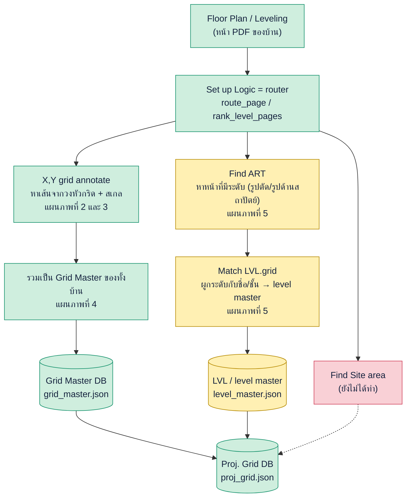
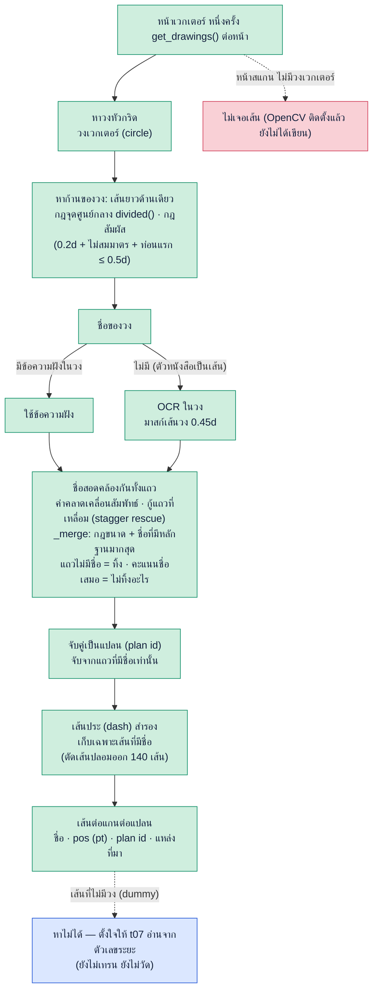
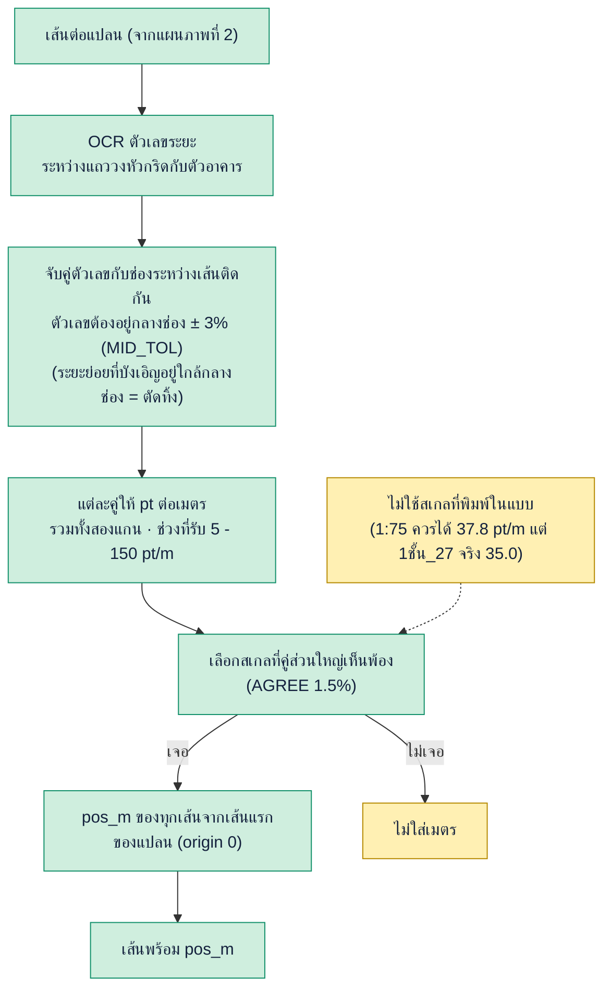
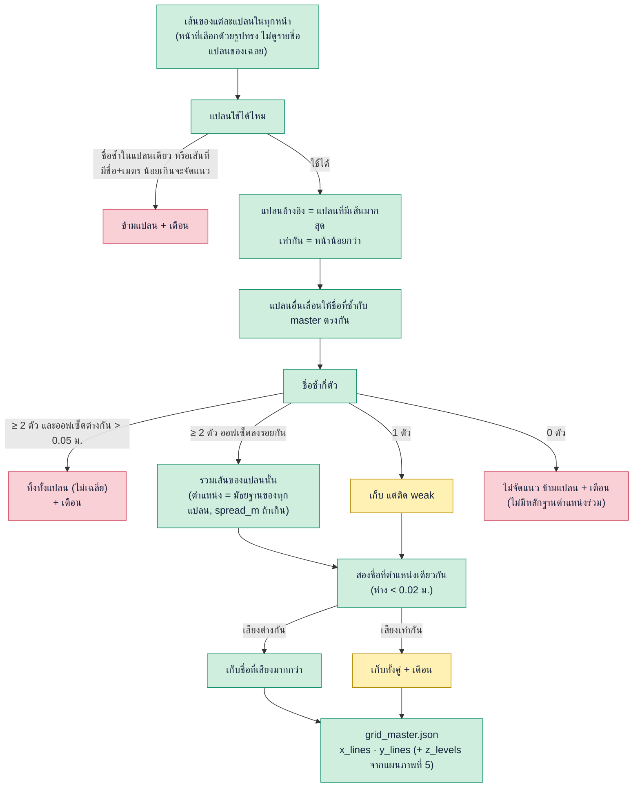
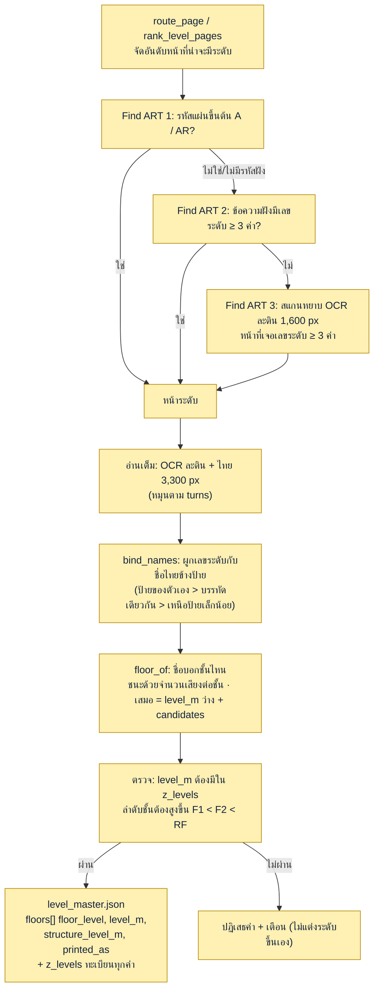
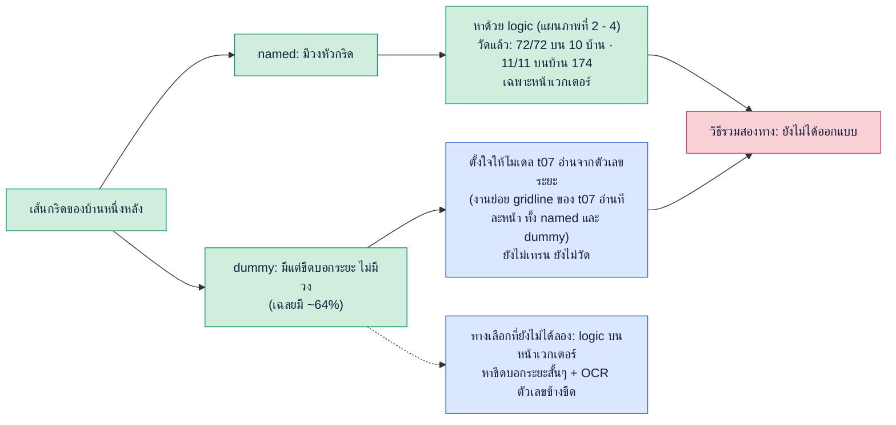

# Pass 3 — เส้นกริด / สเกล / Grid Master DB / Level master / Proj. Grid DB

สถานะ 21 พ.ย. 2569 · โค้ด: `tools/gridlab_probe.py` (หาเส้น) · `tools/gridlab_scale.py` (สเกลและเมตร) · `tools/pass3_grid.py` (รวมเป็น master + ระดับ) · `tools/levelarm_probe.py` (อ่านระดับ)
สี: 🟩 ทำแล้วและวัดแล้ว · 🟨 ทำบางส่วน/ผลยังใช้ไม่ได้ · 🟥 ยังไม่ได้ทำ · 🟦 ข้อเสนอ/ตั้งใจให้ t07

## แผนภาพที่ 1 ภาพรวมเทียบแผนภาพ Grid Ref Detect ของ King

ที่ใช้ได้จริงตอนนี้: เส้นกริดชนิด named บนหน้าเวกเตอร์ → Grid Master · ระดับ (Leveling) ยังใช้ไม่ได้ · Find Site area ยังไม่ได้ทำ

## แผนภาพที่ 2 หาเส้นกริดจากวงหัวกริด (`gridlab_probe.detect()`)

ผลวัดกับเฉลย (2 หน้าแปลนต่อบ้านที่มี grid master, 276 แกน): ชื่อเส้นตรงทั้งชุด **251 (91%)** (ก่อนเปลี่ยนวิธี 54) · ได้ไม่ครบ 7 (ส่วนใหญ่เพราะหน้านั้นวาดกริดน้อยกว่า master ของบ้าน และเฉลยบางจุดผิดเอง) · ไม่เจอเส้น 18 (16 หน้าสแกน, `2ชั้น_22` หน้า 14, `1ชั้น_03` หน้า 11 แกน x เจอ 1 จาก 3) · เส้นเกินเฉลย 0 · ตำแหน่ง: 282 จาก 283 แกนที่มี ≥ 3 เส้น คลาด ≤ 2 ซม.
รีวิวหักล้าง: รอบ 1 agent 18 ตัว 37 หน้า แล้วแก้ · รอบ 2 หน้าใหม่ 32 หน้า ผ่าน 25 ผิด 7 แก้ 5 (ตรวจซ้ำด้วย detect() ไม่ได้ให้ agent ตัดสินใหม่) · **ยังไม่แก้ 2:** หน้ารายละเอียดที่วงจุดเหล็ก/เสาเข็มหกเหลี่ยมถูกอ่านเป็นเส้นกริด (`1ชั้น_04` หน้า 36, `2ชั้น_07` หน้า 27 · ตัวรันข้ามเพราะมีแกนเดียว) · ทำกฎเสียทีละข้อ 18 ข้อ `--demo` จับได้ครบ

## แผนภาพที่ 3 สเกลและเมตร (`gridlab_scale.py`)

ผลวัด: เจอสเกล 154/155 แปลน · ช่องระหว่างเส้นติดกันคลาด ≤ 2 ซม. 841/842 · **พลาดตอนร่างแรก:** MID_TOL 8% รับระยะ 0.50 ที่ห่างกลางช่อง 8.5 pt ได้สเกลปลอม 210 pt/m (`1ชั้น_27` หน้า 11) → แก้เป็น 3% + ช่วง + เคสใน demo
**ข้อจำกัด:** ตัวเลขระยะย่อยใช้เพื่อหาสเกลเท่านั้น ไม่ได้ใช้สร้างเส้น dummy · ต้องมีตัวเลขระยะอยู่ระหว่างวงหัวกริดกับตัวอาคาร · โซ่ระยะอีกฝั่งยังไม่ได้อ่าน · ถ้าแบบวาดวงห่างขีดบอกระยะ เส้นตามวง (เช่น `2ชั้น_07` หน้า 5 คลาด 0.18 ม.)

## แผนภาพที่ 4 รวมเป็น Grid Master ของทั้งบ้าน (`pass3_grid.merge_plans / merge_axis`)

ผลเทียบเฉลย (10 บ้านเวกเตอร์ จาก 72 บ้านที่มี grid master เลือกทุกบ้านที่ 4): ชื่อเส้น named **72/72** ไม่ขาดไม่เกิน · ช่อง **52/52** ภายใน 2 ซม. · บ้าน 174 (17 แปลน, 37 นาทีขณะมีงานอื่นรัน): **11/11** เส้น **9/9** ช่อง
**in-sample บางส่วน:** รอบแรกเกิน 2 เส้น (OCR อ่าน 1 เป็น 7 ใน `1ชั้น_03` กับ `2ชั้น_08`) กฎ "ตำแหน่งเดียวกัน" เพิ่มหลังเห็นผล · ตัวหาเส้นจูนบน 2 หน้าแรกของบ้านชุดเดียวกัน · ทำกฎเสีย 30 ข้อ (รวมส่วนระดับ) `--demo` จับได้ครบ
**ไม่มี:** เส้น dummy (เฉลยมี ~64%) · `dimension_chains` / `unassigned_dimensions` ตามสเปก grid master

## แผนภาพที่ 5 Leveling: หาหน้าระดับ → อ่านเลข → ผูกชื่อ → level master

**ผล: ใช้ไม่ได้ตอนนี้ (อย่ารายงานว่า Leveling เสร็จ)**
- Find ART 1 จากรหัสแผ่น: ใน 129 หน้าที่เฉลยอ่านระดับ (40 เล่ม) มีรหัสข้อความฝัง 3 หน้า และไม่มีรหัสขึ้นต้น A เลย · 26 จาก 40 เล่มไม่มีรหัสฝังสักหน้า · ทางสำรองข้อความฝัง ถูก 0 จาก 6 หน้า
- OCR เลขระดับ: ในชุดวัด 43 หน้า 76 ค่าที่เฉลยมีชื่อไทยพิมพ์ เจอตัวเลข 60 (79%) · ชื่อไทยตรง ≥ 0.8 อยู่ 48 (80% ของที่เจอ) ผิด 11 · กฎปรับบนชุด 43 หน้าชุดเดียวกัน ไม่มีชุดแยกทดสอบ
- **บ้าน 174 (ชุดเดียวที่มี level master เฉลย, ไฟล์เฉลยสร้างโดย session ก่อน ยังไม่มีคนตรวจ): level master ได้ 0/9 ชั้น** · สแกนหยาบเจอหน้าระดับ 4 จาก 26 หน้า · อ่านค่าได้ 11 ค่า ตรงเฉลย 2 ค่า (-1.00, +1.90) · ไม่มีชื่อไทยผูก จึงกำหนดชั้นไม่ได้
- ยังไม่ได้ลอง: สแกนที่ความละเอียดสูงขึ้น · ใช้ชื่อแผ่นจาก Pass 1 เลือกหน้ารูปตัด/รูปด้าน · กำหนดชั้นจากลำดับระดับแทนชื่อไทย

## แผนภาพที่ 6 ใครหาเส้นชนิดไหน (named / dummy)

รายละเอียดการแบ่งงานนี้จดไว้ที่ `tune_ai/t07_Palfrey/pass_gridline/README.md`
