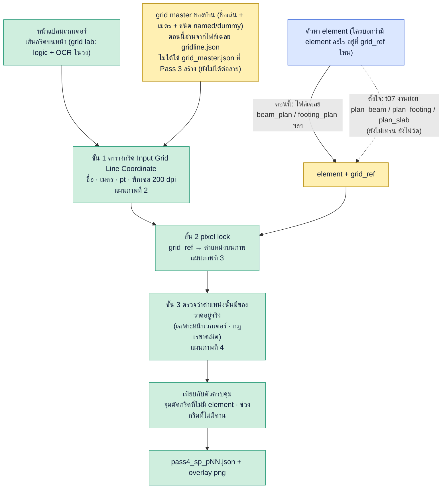
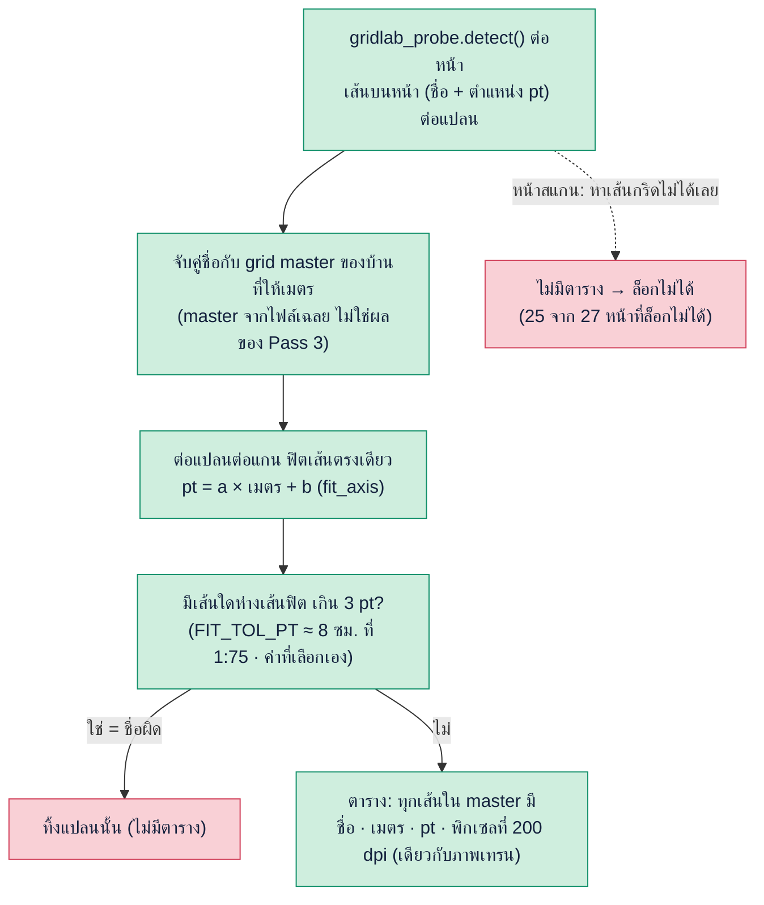
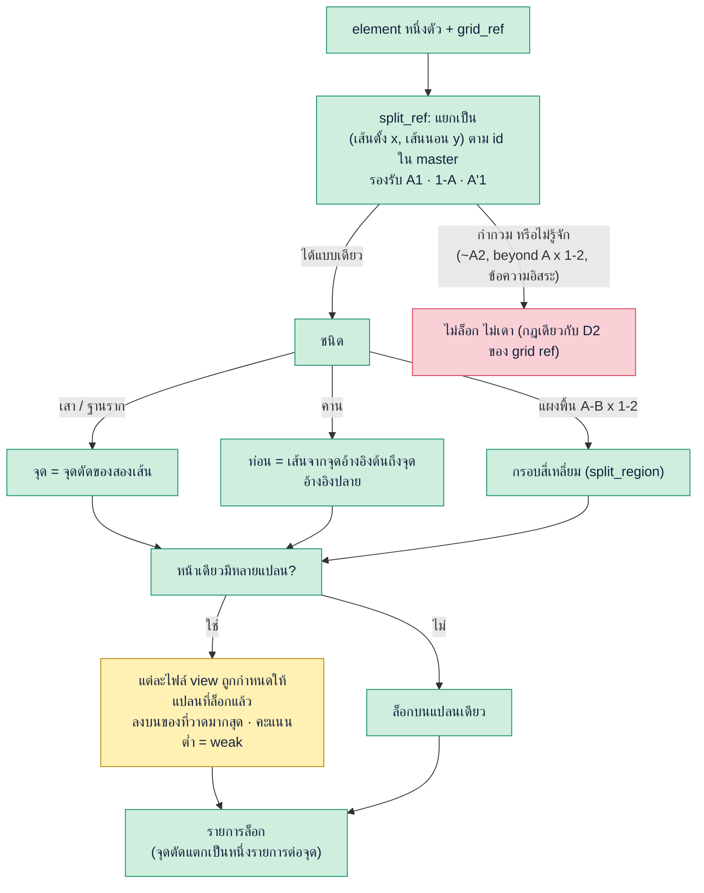
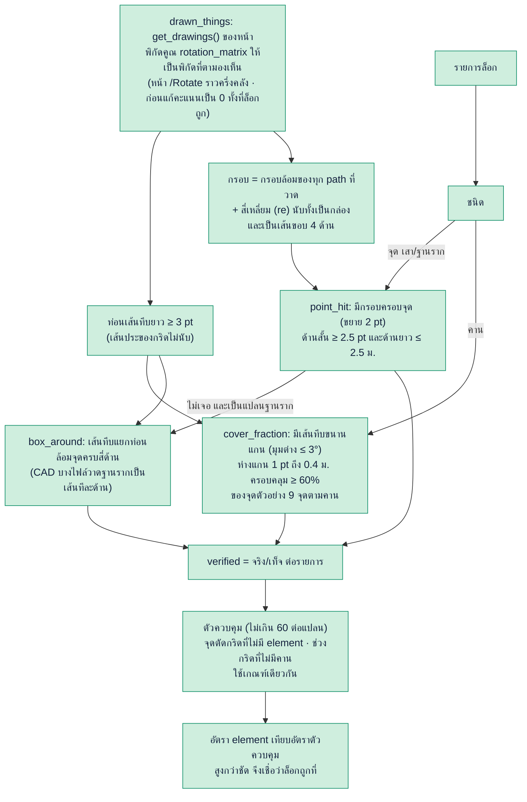

# Pass 4 — SP (แปลนโครงสร้าง): ตารางกริด · pixel lock · ตรวจกับของที่วาด

สถานะ 21 พ.ย. 2569 · โค้ด: `tools/pass4_sp.py` (session อื่นของมะขามสร้าง ยังไม่ commit) · **ไม่เรียกโมเดล**
สี: 🟩 ทำแล้วและวัดแล้ว · 🟨 ทำบางส่วน · 🟥 ยังไม่ได้ทำ · 🟦 ตั้งใจให้ t07 (ยังไม่เทรน)

> **ข้อควรรู้ก่อนอธิบาย Pass 4:** ตอนนี้ยังไม่มีโมเดลอ่านแปลนที่เทรนแล้ว ไฟล์นี้จึง**ไม่ได้หา element จากภาพ** มันใช้ element ในไฟล์เฉลย (`beam_plan`, `footing_plan` ฯลฯ) เป็นตัวแทนสิ่งที่โมเดลจะอ่าน **และใช้ grid master (ชื่อเส้น + เมตร) จากไฟล์เฉลยด้วย** (`load_master()` อ่าน `*gridline*.json`) ไม่ใช่ `grid_master.json` ที่ Pass 3 สร้าง Pass 3 → Pass 4 ยังไม่ได้ต่อสาย ส่วนที่เป็น logic/OCR จริงคือเส้นกริดและตำแหน่งบนหน้า (ผ่าน `gridlab_probe.detect(ocr=True)`) ตัวเลขทุกตัวจึงวัด "ตารางกริดที่ส่งให้ + การล็อกพิกเซล + การตรวจกับของที่วาด" ไม่ได้วัดความสามารถอ่านแบบของโมเดล

## แผนภาพที่ 1 ภาพรวม: ใครทำอะไร

**Pass 4 ตอนนี้ไม่ได้หา element:** ตำแหน่งที่จะไปดูมาจาก element ในเฉลยที่รู้ชื่อและ grid_ref อยู่แล้ว สิ่งที่พิสูจน์แล้วคือ "ล็อกตำแหน่งแล้วมีของวาดอยู่จริง" ไม่ใช่ "หา element ได้"

## แผนภาพที่ 2 ขั้น 1: ตารางกริดสำหรับ "Analyze SP"

## แผนภาพที่ 3 ขั้น 2: pixel lock (grid_ref → ตำแหน่งบนภาพ)

ผล: ล็อกได้ 26 หน้า · 32 ไฟล์ element · 466 element → 845 รายการล็อก · แผงพื้น 126 กรอบ · ref ที่ไม่ล็อก 64 · ไฟล์ weak 5 (`etc_plan` 4: ref เป็นข้อความอิสระ · `roof_frame_plan` 1: เกณฑ์คานไม่เหมาะกับโครงเหล็ก)
**ตัวอย่างที่ล็อกพลาด:** `1ชั้น_25` หน้า 24 สองแปลน (ซ้าย ฐานราก, ขวา คาน) แต่ overlay ของคานและแผงพื้นไปอยู่บนแปลนซ้าย ยังไม่ได้ตรวจว่าทำไมเลือกแปลนซ้าย

## แผนภาพที่ 4 ขั้น 3: ตรวจกับของที่วาดจริง (หน้าเวกเตอร์) เทียบตัวควบคุม

สีใน overlay: ม่วงแดง = จุดเสา/ฐานราก (ติดชื่อ element) · เขียว = คานที่ล็อกแล้วเจอของที่วาดจริง · ส้ม = คานที่ล็อกแล้วแต่ไม่เจอ · น้ำเงิน = แผงพื้น

## ผลวัด (`pass4_sp.py --eval` ทุกเล่มที่ 6 ที่มี grid master, 2 หน้าแปลนต่อเล่ม, 53 หน้า)

| อะไร | ผล |
|---|---|
| ฐานราก / เสา (จุด) | **99.5%** อยู่บนของที่วาดจริง (n = 418) เทียบตัวควบคุม **16.8%** (n = 2,545) |
| คาน | **92.7%** (n = 301) เทียบตัวควบคุม **16.5%** (n = 2,191) |
| หน้าที่ล็อกไม่ได้ | 27 หน้า: 25 เป็นหน้าสแกน (หาเส้นกริดไม่ได้เลย) · 2 เป็นหน้ารายละเอียดเวกเตอร์ |
| ตัวเช็คในตัว | ทำกฎเสีย 20 ข้อ จับได้ครบ 20 (รอบแรกรอด 4+1 ได้เพิ่มเทสต์) |

## ที่ผลวัดเหล่านี้ไม่ได้บอก

- **"เจอของที่วาด" ไม่ได้แปลว่าเป็น mark ที่ถูก:** สลับ mark สองตัวที่ตำแหน่งถูกต้อง ตัวตรวจนี้จับไม่ได้
- **ตัวควบคุม ~17% ไม่ใช่ศูนย์** เพราะคานกับเสาอยู่บนหลายจุดตัดกริด และกรอบนับจากเส้นทุกเส้น ต้องอ่านตัวเลขคู่กับตัวควบคุมเสมอ
- **ไม่ใช่การหา element:** ถ้ากวาดทุกจุดตัดกริดหาเสาด้วยรูปทรงล้วนๆ จะได้เสาปลอมราว 1 ใน 6 ของจุดตัดว่าง และรูปทรงบอกไม่ได้ว่าเป็น C1 หรือ C2
- ตัวเลขทั้งหมดเป็นของหน้าเวกเตอร์ · หน้าสแกนยังไม่ได้ทำ

## ยังไม่ได้ทำ

- อ่าน element ด้วยโมเดลโดยให้ตารางกริดเป็นอินพุต (ต้อง t07 ที่เทรนแล้วบนการ์ด)
- หน้าสแกน 25 หน้า (ติดที่ Pass 3 ยังหาเส้นกริดบนภาพไม่ได้) · ref ประมาณ `~A2` · ห้อง (`etc_plan`) · สมาชิกโครงหลังคา · ตรวจแผงพื้น · ขนาดพิกเซลของ element (มีแค่จุดกลาง/เส้น ไม่มีความกว้าง) · ต่อเข้า overlay ของ Constistant (งานของอิมบน `feat/im-overlay-promax`)
- ค้างให้มะขามตัดสิน: ref ประมาณ `~A2` ควรล็อกที่จุดตัดใกล้สุดพร้อมธง หรือคงไม่ล็อก
