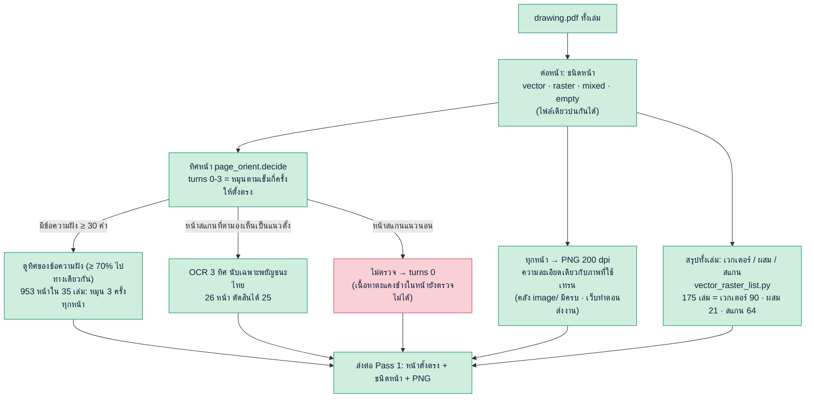
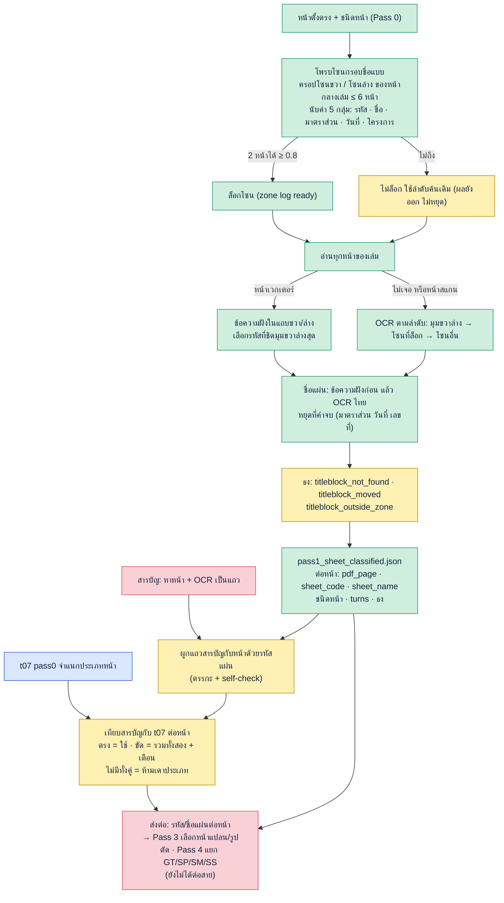
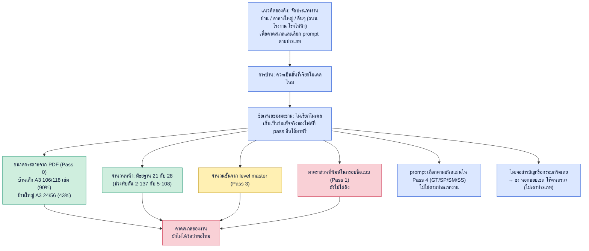
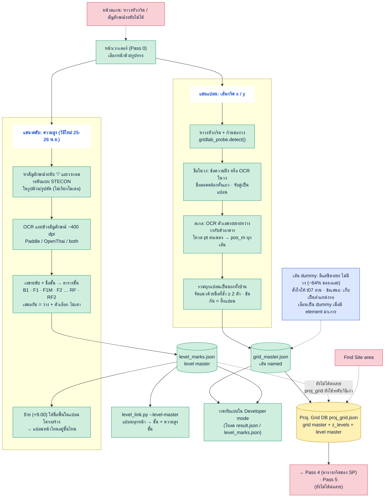
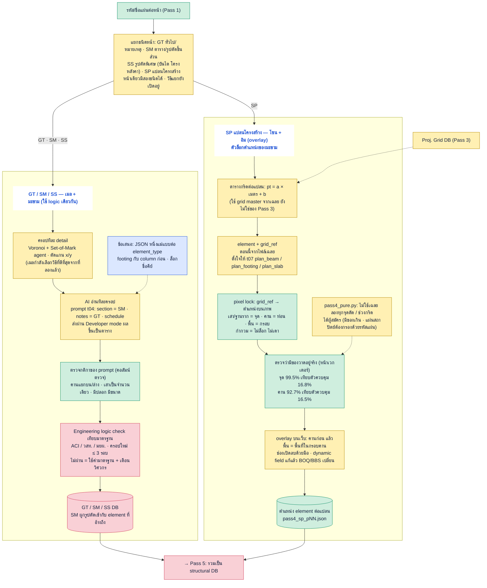
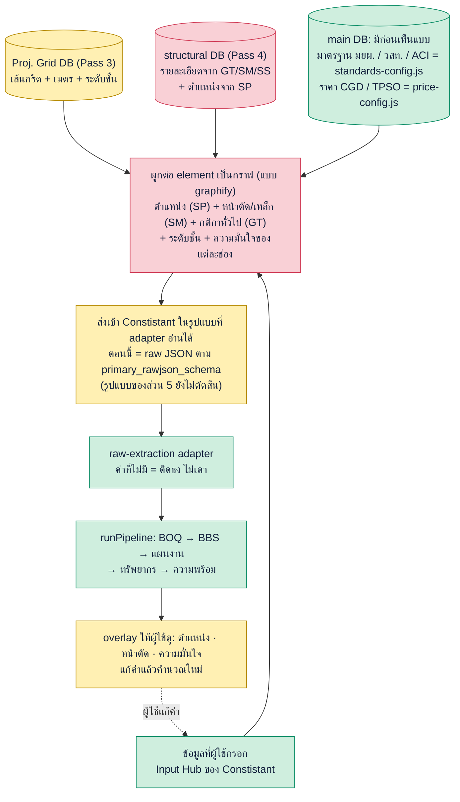

# Pipeline ทุก pass ตั้งแต่ต้นจนจบ — 1 pass 1 แผนภาพ

สถานะ 27 พ.ย. 2569 · เรียงตามลำดับที่ไฟล์แบบวิ่งผ่านจริง · เลข pass ตามชุด `../mermaid_21พย2569/` (ชุดนั้นมีแผนภาพละเอียดหลายรูปของ Pass 1, 3, 4) · "ส่วน N" = 5 ส่วนของคิง (ประชุม 19 พ.ย.) · เจ้าของงานตามที่แบ่งในประชุม 25 พ.ย.
สี: 🟩 ทำแล้วและวัดแล้ว · 🟨 ทำบางส่วน / ยังไม่ได้วัดกับงานจริง · 🟥 ยังไม่ได้ทำ · 🟦 ข้อเสนอ หรือตั้งใจให้โมเดล t07 (ยังไม่เทรน)

| Pass | ทำอะไร | ส่วนของคิง | เจ้าของ | สถานะโดยรวม |
|---|---|---|---|---|
| 0 | เตรียมไฟล์: ชนิดหน้า + ทิศหน้า | ส่วน 1 | มะขาม | 🟩 หน้าเวกเตอร์ · 🟨 หน้าสแกน |
| 1 | กรอบชื่อแบบ → รหัสแผ่น / ชื่อแผ่นต่อหน้า (+ สารบัญ) | ส่วน 1 | มะขาม | 🟩 รหัสแผ่น · 🟨 สารบัญ |
| 2 | ประเภทงานก่อสร้าง | ส่วน 2 | ข้อเสนอของมะขาม รอทีมตัดสิน | 🟦 |
| 3 | เส้นกริด (แนวนอน) + ระดับ (แนวตั้ง) → Proj. Grid DB | ส่วน 3 | มะขาม | 🟩 หน้าเวกเตอร์ · 🟥 หน้าสแกน · 🟥 เส้น dummy |
| 4 | หา element: GT / SM / SS และ SP | ส่วน 4 | เมล + มะขาม (GT/SM/SS) · โซน + อิม (SP, overlay) | 🟨 |
| 5 | Matching: รวมทุกฐานข้อมูล → Constistant | ส่วน 5 | ยังไม่ได้แบ่ง | 🟥 ฝั่งรวม · 🟩 ฝั่ง Constistant ที่รับ |

---

## Pass 0 — เตรียมไฟล์: ชนิดหน้า + ทิศหน้า (ส่วน 1)

โค้ด: `tools/page_orient.py` · `tools/vector_raster_list.py` · ชนิดหน้า `page_info` (ตัวรันใน `tools/`)

ตัดสินในประชุม 25 พ.ย.: ทำเล่มเวกเตอร์ก่อน (บอก STECON ด้วย) · STECON ดอยคำ: เล่ม 05 (รายการคำนวณ) เป็นสแกน ที่เหลือเวกเตอร์ · รายชื่อทุกเล่มพร้อมเลขหน้าที่เป็นสแกน: `docs/pipeline_5_ส่วน/เล่มแบบ_เวกเตอร์_สแกน.csv`
ยังไม่ได้ทำ: ตัวจำแนกทิศสำเร็จรูป (PP-LCNet) ผิดราว 94% บนหน้าแนวนอน จึงไม่ใช้ · หน้าสแกนแนวนอนที่เนื้อหาข้างในตะแคงยังไม่มีวิธีตรวจ

---

## Pass 1 — กรอบชื่อแบบ → รหัสแผ่น / ชื่อแผ่นต่อหน้า (ส่วน 1)

โค้ด: `tools/pass1_sheet_classify.py` · `tools/titleblock_extract.py` · `tools/pass1_toc.py` (ตรรกะสารบัญ)

ผลที่วัด: รหัสแผ่นถูก 475/475 บนหน้าที่เฉลยเป็นรหัสตัวอักษร+เลข (33 เล่ม) · โพรบ 15 เล่มบ้านเล็ก: เจอ 183/205 **ผิด 0** (ที่ไม่เจอ 22 หน้าอยู่ในเล่มเดียว `1ชั้น_06` ซึ่งหน้ากลางเล่มเป็น BOQ เลยไม่ล็อกโซน)
ยังไม่พิสูจน์: `titleblock_moved` ยังไม่เคยเจอกรอบที่ย้ายจริงในคลัง 175 เล่ม · การหาหน้าสารบัญและ OCR สารบัญเป็นแถวยังไม่ได้ทำ · t07 ยังไม่เทรน · Pass 3 และ 4 ยังไม่ได้ใช้รหัสแผ่นจาก pass นี้ (Pass 3 เลือกหน้าด้วยรูปทรง)

---

## Pass 2 — ประเภทงานก่อสร้าง (ส่วน 2) · ข้อเสนอ รอทีมตัดสิน

ที่มา: `docs/pipeline_5_ส่วน/การบ้าน_2026-11-20.md` ข้อ 1 · ไม่มีโค้ด

เหตุผลของข้อเสนอ: คลัง 175 เล่มเป็นบ้านหรืออาคารล้วน ไม่มีงาน "อื่นๆ" ให้สอบ ตัวจัดประเภทที่ตอบ "อื่นๆ" จึงพิสูจน์ไม่ได้ · ทุกขั้นที่เพิ่ม = จุดพัง เวลารัน และหน่วยความจำที่เพิ่มขึ้น
ความเสี่ยงที่รับ: ถ้างานจริงของ STECON ต้องการ prompt คนละแบบกับบ้าน จะรู้ก็ต่อเมื่อเห็นผลพัง · กลับมาพิจารณาเมื่อ prompt เดียวกันพังซ้ำกับอาคารใหญ่และ prompt เฉพาะประเภทแก้ได้

---

## Pass 3 — เส้นกริด (แนวนอน) + ระดับ (แนวตั้ง) → Proj. Grid DB (ส่วน 3)

โค้ด: `tools/gridlab_probe.py` · `tools/gridlab_scale.py` · `tools/pass3_grid.py` · `tools/level_marks.py` · `tools/level_link.py`

ผลที่วัด (หน้าเวกเตอร์เท่านั้น): ชื่อเส้นต่อหน้าตรงทั้งชุด 251/276 แกน (91%) · สเกลเจอ 154/155 แปลน ช่องระหว่างเส้นคลาด ≤ 2 ซม. 841/842 · grid master เส้น named 72/72 บน 10 บ้าน ช่อง 52/52 · บ้าน 174 11/11
ระดับ: เล่มเวกเตอร์ในเฉลย ชั้นถูก 28/28 ผิด 0 · ค่าที่อ่านได้เป็นระดับจริง 98% · โหมด both อ่านได้ 113/180 ระดับ · STECON ดอยคำครบ 9 ชั้น · ป้าย (+9.00) ในแปลนโครงสร้าง STECON ลงชั้นถูก 16/17 ผิด 0 · เล่ม 174: แปลน 18 หน้าลง 9 ชั้น ไม่มีธง
ยังไม่ได้ทำ: หน้าสแกนทั้งสองแขน · เส้น dummy · ต่อ level_marks.json เข้า proj_grid · Find Site area · Pass 4 ยังใช้ grid master จากเฉลย ไม่ใช่ของ pass นี้

---

## Pass 4 — หา element: GT / SM / SS และ SP (ส่วน 4)

โค้ด: SP = `tools/pass4_sp.py` · `tools/pass4_pure.py` · อ่านครอป = Constistant `js/dev/dev-mode.js` (งาน `single_call` → `worker.py run_single_call`) · prompt = `tune_ai/t04_Purson/pass2/`

ผลที่วัด (SP, `pass4_sp.py --eval` ทุกเล่มที่ 6 ที่มี grid master, 53 หน้า): ล็อกได้ 26 หน้า 466 element · ล็อกไม่ได้ 27 หน้า (25 เป็นหน้าสแกน) · `pass4_pure.py` บน `1ชั้น_27` หน้า 10: จุด 32/32 คาน 28/28 ไม่เกิน · แต่แผ่นสถาปัตย์ (A-03, A-04) ก็ได้คาน 16-27 ช่วง จึงต้องกรองด้วยรหัสแผ่นจาก Pass 1 ก่อน
GT/SM/SS: ทางส่งครอปให้ AI อ่าน (Developer mode) ทำแล้ว ทดสอบในเบราว์เซอร์กับ Supabase จำลอง แต่**ยังไม่เคยส่งผ่านการ์ดจริง** · คอลัมน์ตรวจเช็คแค่กติกาที่ prompt เขียนไว้ ไม่ใช่ engineering logic
ที่ตัวเลข SP ไม่ได้บอก: "เจอของที่วาด" ไม่ได้แปลว่า mark ถูก (สลับ C1 กับ C2 ที่ตำแหน่งถูกต้องจับไม่ได้) · ตัวควบคุมราว 17% ไม่ใช่ศูนย์ ต้องอ่านคู่กันเสมอ
ยังไม่ได้ทำ: engineering logic check · ฐานข้อมูล GT/SM/SS · ผูกรูปตัดกับ element · ให้โมเดลหา element บนแปลนเอง (ต้อง t07 ที่เทรนแล้ว) · หน้าสแกน · ต่อ grid master จาก Pass 3

---

## Pass 5 — Matching: รวมทุกฐานข้อมูล → Constistant (ส่วน 5)

ฝั่งที่รับมีอยู่แล้วใน Constistant: `js/drawing/raw-extraction-adapter.js` · `js/shared/pipeline.js` · `js/shared/standards-config.js` · `js/shared/price-config.js` · Input Hub

ตอนนี้ทางที่วิ่งครบจริงคือทางเก่า: Destrier อ่านทั้งเล่ม → raw JSON → adapter → BOQ · ส่วน 5 ของไปป์ไลน์ใหม่ (ผูกเป็นกราฟ) ยังไม่ได้เริ่ม และยังไม่ได้แบ่งเจ้าของ
ต้องตัดสิน: รูปแบบที่ส่วน 5 ส่งให้ Constistant (ใช้ raw JSON เดิมต่อ หรือรูปแบบใหม่) · ใครเป็นเจ้าของ dynamic field ฝั่ง overlay (ประชุม 25 พ.ย. ยังไม่ตกลงว่าอิมหรือแทน)
