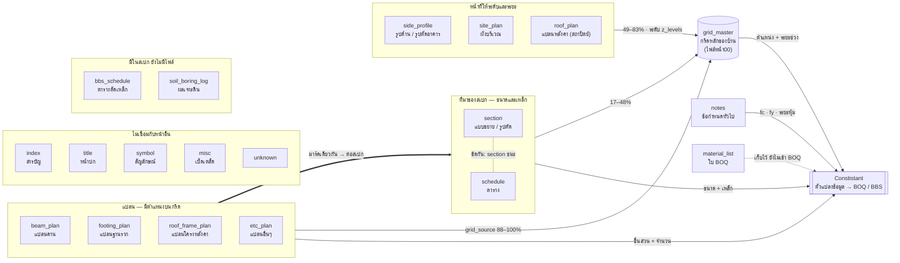

# pattern ไหนเชื่อมกับอันไหน — primary rawjson

นับจากไฟล์จริง 16 พ.ย. 69 (194 บ้าน บ้านละหนึ่งฉบับ)

## ตัวเลขแยกราย pattern

**ต่อสเปก** (`element_id` เดียวกันโผล่ทั้งในแปลนและหน้าสเปกของบ้านเดียวกัน — สเปก §7) · จำนวนมาร์คที่ตรงกัน / จำนวนบ้าน

| แปลน | → section | → schedule |
|---|---|---|
| beam_plan | 1,680 / 145 | 49 / 17 |
| footing_plan | 641 / 155 | 97 / 36 |
| etc_plan | 506 / 48 | 85 / 19 |
| roof_frame_plan | 310 / 72 | 0 |

**`grid_source`** (ไฟล์ระบุชื่อไฟล์กริดหลัก) — beam_plan, footing_plan, roof_frame_plan 100% · etc_plan 88% · roof_plan 83% · site_plan 53% · side_profile 49% · section 48% · schedule 17% · notes 1% · ที่เหลือ 0%

## หมายเหตุ
- ทุกหน้าที่พิมพ์ระยะหรือระดับ ต้องส่งตัวเลขเข้า `grid_master` (สเปก §4) — ในรูปวาดเฉพาะกลุ่มที่มี `grid_source`
- Constistant อ่าน 9 ประเภท: แปลน 4 แบบ, `section`, `schedule`, `notes`, `grid_master`, `material_list` · ที่เหลือเก็บดิบพร้อมคำเตือน
