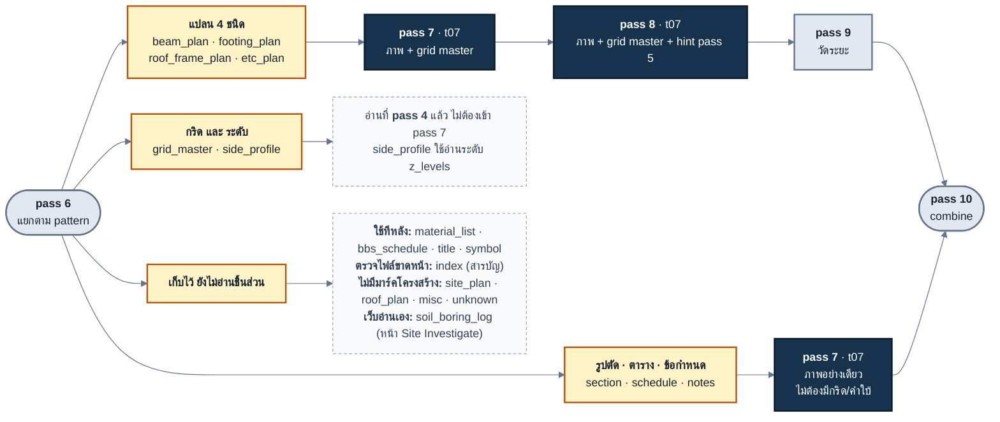

# แผนผังระบบ 10 pass (สร้างจาก `pass_ทำอะไร.csv` ฉบับแก้ 18 พ.ย. 69)

สี: **น้ำเงินเข้ม = โมเดล t07 (AI บนการ์ด)** · **เขียวน้ำทะเล = cv2** · **เทา = โค้ดธรรมดา (ไม่เดา)** · **เหลือง = t07 + โค้ดตรวจ** · **เขียว = ฝั่งเว็บ**

## 1) ภาพรวมทั้ง 10 pass (เรียงตามลำดับทำงาน)

```mermaid
%%{init: {"theme":"base","themeVariables":{"fontFamily":"Leelawadee UI, Tahoma, sans-serif","fontSize":"15px","lineColor":"#64748b","edgeLabelBackground":"#ffffff"},"flowchart":{"curve":"basis","nodeSpacing":36,"rankSpacing":36,"padding":14}}}%%
flowchart TD
  WEB0(["<b>เว็บเตรียมไฟล์</b><br/>PDF → PNG 200 dpi + vectors_v1.json"]):::web

  subgraph G1["① ทำความเข้าใจแบบ"]
    direction TB
    P1["<b>pass 1 · ดึงข้อความ</b><br/>อ่านจาก vectors_v1.json ไม่ต้อง OCR<br/>หน้าสแกนค่อย OCR กรอบชื่อแบบ<br/><i>ส่ง: ข้อความรายหน้า + สารบัญ</i>"]:::code
    P2["<b>pass 2 · จำแนกรายวิว</b><br/>หน้าเดียวมีได้หลายวิว<br/><i>ส่ง: views[] (ตำแหน่ง · pattern · อาคาร)</i>"]:::ai
    P3["<b>pass 3 · ตัดวิว</b><br/>organize.py บน/ล่าง + ซ้าย/ขวา<br/><i>ส่ง: ครอปรายวิว + manifest</i>"]:::code
    P1 --> P2 --> P3
  end

  subgraph G2["② ผังกริดและชี้เป้า"]
    direction TB
    P4["<b>pass 4 · Grid master</b><br/>แยกตามอาคาร · ตรวจ 4 ข้อก่อนใช้<br/><i>ส่ง: x/y lines + z_levels + ผลตรวจ</i>"]:::check
    P5["<b>pass 5 · cv2 หา element</b><br/>ไม่เจอชิ้นเลย = ตัดผิด → ใช้เต็มหน้า<br/><i>ส่ง: #n + พิกัด + จำนวนต่อชนิด</i>"]:::cv
    P4 --> P5
  end

  subgraph G3["③ อ่านชิ้นส่วน"]
    direction TB
    P6["<b>pass 6 · จัดระเบียบ</b><br/>รวมผล pass 3, 4, 5 แล้วแยกโฟลเดอร์ตาม pattern"]:::code
    P7["<b>pass 7 · t07 หา element</b><br/>prompt ต่างกันตาม pattern<br/>ใช้ grid master จาก pass 4"]:::ai
    P8["<b>pass 8 · t07 + คำใบ้</b><br/>เฉพาะแปลน 4 ชนิด · hint จาก pass 5"]:::ai
    P6 --> P7 --> P8
  end

  subgraph G4["④ วัดระยะและรวมผล"]
    direction TB
    P9["<b>pass 9 · วัดระยะ</b><br/>ไม้บรรทัดเวกเตอร์ก่อน · CV เป็นตัวสำรอง<br/>รายงานอย่างเดียว ไม่ทับผลที่อ่านมา"]:::code
    P10["<b>pass 10 · combine</b><br/>โค้ดล้วน ไม่ใช้โมเดล<br/><i>ส่ง: raw JSON รายวิว + ธง + ที่มาต่อชิ้น</i>"]:::code
    P9 --> P10
  end

  WEB1(["<b>เว็บ</b><br/>ตรวจ → ยืนยันนำเข้า → BOQ"]):::web

  WEB0 --> G1
  G1 --> G2
  G2 --> G3
  G3 --> G4
  G4 --> WEB1

  classDef ai fill:#17324d,stroke:#0b1b2b,color:#fff,stroke-width:2px;
  classDef cv fill:#0f766e,stroke:#0a4f4a,color:#fff,stroke-width:2px;
  classDef code fill:#e2e8f0,stroke:#64748b,color:#1b2430,stroke-width:2px;
  classDef check fill:#fde68a,stroke:#b45309,color:#1b2430,stroke-width:2px;
  classDef web fill:#16a34a,stroke:#166534,color:#fff,stroke-width:2px;
  style G1 fill:#f8fafc,stroke:#cbd5e1,color:#334155
  style G2 fill:#f8fafc,stroke:#cbd5e1,color:#334155
  style G3 fill:#f8fafc,stroke:#cbd5e1,color:#334155
  style G4 fill:#f8fafc,stroke:#cbd5e1,color:#334155
```

## 2) แต่ละชนิดหน้าแบบ (pattern) ไปทางไหน

## หมายเหตุสั้นๆ (จากคอลัมน์ "แก้อะไร / ทำไม")

- **pass 1:** 22 จาก 53 เล่มเป็น PDF จาก CAD มีข้อความฝังอยู่แล้ว · OCR ไทยต้อง ≥ 180 dpi ไม่งั้นสระหลุด
- **pass 2:** หน้าเดียวมีหลายวิว (บ้าน 83b8e52c หน้า 20 มีแปลน 2 ชั้นในแผ่นเดียว เคยอ่านเป็น F1 หมด) · ข้อความจาก pass 1 เข้า prompt ได้เมื่อ t07 เทรนด้วยรูปแบบนี้
- **pass 4:** กริดผิดตัวเดียว BOQ เกิน 30.8% (อ่านได้ 0/6/12 แทน 3+3) จึงต้องตรวจก่อนแนบเข้า prompt
- **pass 8:** รูปแบบคำใบ้ต้องมีในชุดเทรน t07 ไม่งั้นห้ามส่ง
- **pass 9:** วัดจาก CV อย่างเดียวเคยได้ 0/9 หน้าในงานจริง · เวกเตอร์วัดได้ 68/98 หน้า CAD (แปลนคาน 38/47) · ห้ามเอาค่าที่วัดไปทับผลอ่าน
