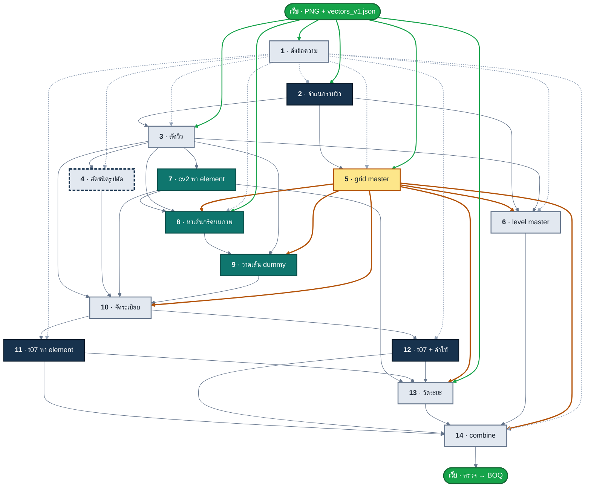
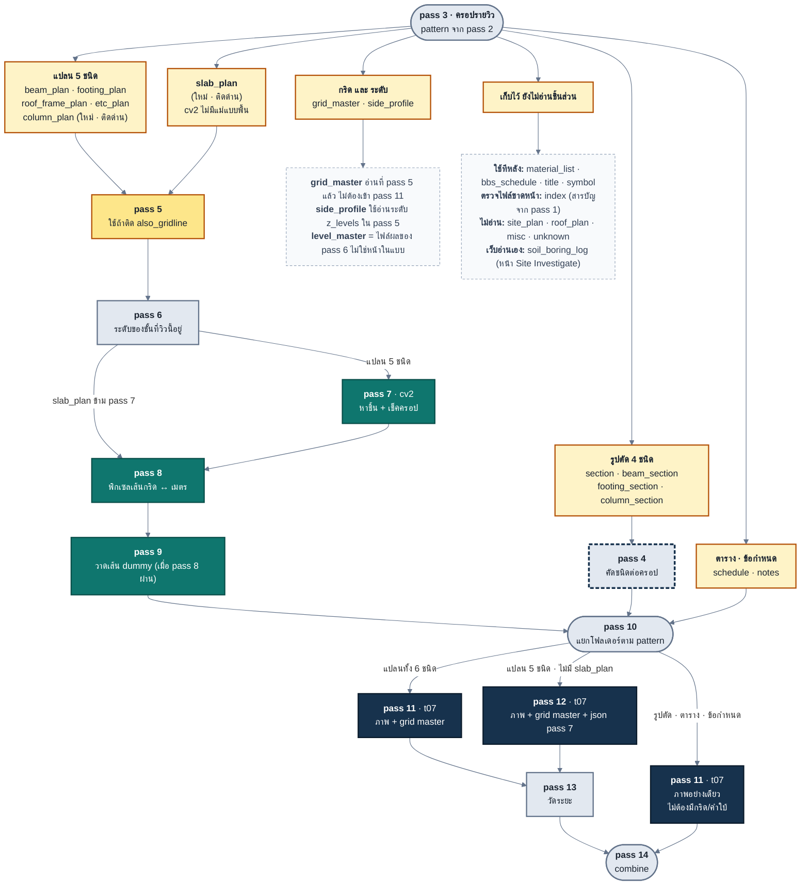

# แผนผังระบบ 14 pass (สร้างจาก `pass_ทำอะไร.csv` ฉบับแก้ 18 พ.ย. 69)

สี: **น้ำเงินเข้ม = โมเดล t07 (AI บนการ์ด)** · **เขียวน้ำทะเล = cv2** · **เทา = โค้ดธรรมดา (ไม่เดา)** · **เหลือง = t07 + โค้ดตรวจ** · **เทา ขอบน้ำเงินประ = โค้ด + t07 สำรอง (ยังไม่ตัดสิน)** · **เขียว = ฝั่งเว็บ**

เลข pass เดิม → ใหม่: 1→1 · 2→2 · 3→3 · 3.5→4 · 4→5 · 4b→6 · 5→7 · 5.5→8 · 5.6→9 · 6→10 · 7→11 · 8→12 · 9→13 · 10→14

## 1) ภาพรวมทั้ง 14 pass (เรียงตามลำดับทำงาน)

```mermaid
%%{init: {"theme":"base","themeVariables":{"fontFamily":"Leelawadee UI, Tahoma, sans-serif","fontSize":"15px","lineColor":"#64748b","edgeLabelBackground":"#ffffff"},"flowchart":{"curve":"basis","nodeSpacing":36,"rankSpacing":36,"padding":14}}}%%
flowchart TD
  WEB0(["<b>เว็บเตรียมไฟล์</b><br/>PDF → PNG 200 dpi + vectors_v1.json"]):::web

  subgraph G1["① อ่านข้อความ จำแนก และตัดวิว"]
    direction TB
    P1["<b>pass 1 · ดึงข้อความ</b><br/>CAD อ่านจาก vectors_v1.json ไม่ต้อง OCR<br/>หน้าสแกนค่อย OCR กรอบชื่อแบบ<br/><i>ส่ง: ข้อความรายหน้า + มาร์คต่อหน้า + สารบัญ</i>"]:::code
    P2["<b>pass 2 · จำแนกรายวิว</b><br/>หน้าเดียวมีได้หลายวิว · ใหม่: column_plan / slab_plan (ติดด่าน)<br/><i>ส่ง: views[] (ตำแหน่ง · pattern · also_gridline · อาคาร)</i>"]:::ai
    P3["<b>pass 3 · ตัดวิว</b><br/>organize.py บน/ล่าง + ซ้าย/ขวา · หน้ารูปตัดตัดทีละรูป<br/><i>ส่ง: ครอปรายวิว + manifest</i>"]:::code
    P4["<b>pass 4 · คัดชนิดรูปตัด</b><br/>beam_section · footing_section<br/>column_section · section (ชนิดอื่น)<br/>โค้ดดูตัวนำหน้ามาร์ค · t07 เมื่อไม่มีมาร์ค (ยังไม่ตัดสิน)"]:::mix
    P1 --> P2 --> P3 --> P4
  end

  subgraph G2["② ผังกริดและระดับชั้น"]
    direction TB
    P5["<b>pass 5 · Grid master</b><br/>รายอาคาร · อ่านทีละหน้าแล้วโค้ดรวม · ตรวจ 4 ข้อ<br/><i>ส่ง: x/y lines + z_levels + ผลตรวจ</i>"]:::check
    P6["<b>pass 6 · Level master</b><br/>ชั้นไหนอยู่ระดับเท่าไร · ผูกวิวแปลนเข้ากับชั้น<br/><i>ส่ง: หน้า00_level.json + ธง (ความสูงชั้นไป pass 14)</i>"]:::code
    P5 --> P6
  end

  subgraph G3["③ ชี้เป้าบนภาพครอป"]
    direction TB
    P7["<b>pass 7 · cv2 หา element</b><br/>แปลน 4 ชนิด + column_plan (ไม่มีแม่แบบพื้น)<br/>ไม่เจอชิ้นเลย = ตัดผิด → ใช้เต็มหน้า<br/><i>ส่ง: #n + พิกัด + จำนวนต่อชนิด</i>"]:::cv
    P8["<b>pass 8 · หาเส้นกริดบนภาพ</b><br/>อย่างน้อย 3 มุม · cv2 + OCR + เวกเตอร์<br/><i>ส่ง: ตัวแปลงพิกเซล ↔ เมตร + ค่าคลาด</i>"]:::cv
    P9["<b>pass 9 · วาดเส้นกริด dummy</b><br/>วาดลงภาพครอปพร้อมชื่อเส้น (2', A'')<br/>วาดเฉพาะเมื่อ pass 8 คลาดน้อย"]:::cv
    P7 --> P8 --> P9
  end

  subgraph G4["④ อ่านชิ้นส่วน"]
    direction TB
    P10["<b>pass 10 · จัดระเบียบ</b><br/>รวมผล pass 3, 4, 5, 7 + ภาพเส้น dummy จาก pass 9<br/>แล้วแยกโฟลเดอร์ตาม pattern"]:::code
    P11["<b>pass 11 · t07 หา element</b><br/>prompt ต่างกันตาม pattern<br/>คานเขียนเป็น span [เริ่ม, จบ, ยาว]"]:::ai
    P12["<b>pass 12 · t07 + คำใบ้</b><br/>เฉพาะแปลน (ไม่รวม slab_plan)<br/>hint จาก pass 7"]:::ai
    P10 --> P11
    P10 --> P12
  end

  subgraph G5["⑤ วัดระยะและรวมผล"]
    direction TB
    P13["<b>pass 13 · วัดระยะ</b><br/>ไม้บรรทัดเวกเตอร์ก่อน · CV เป็นตัวสำรอง<br/>รายงานอย่างเดียว ไม่ทับผลที่อ่านมา"]:::code
    P14["<b>pass 14 · combine</b><br/>โค้ดล้วน ไม่ใช้โมเดล · ใช้ความสูงชั้นจาก pass 6<br/><i>ส่ง: raw JSON รายวิว + ธง + ที่มาต่อชิ้น</i>"]:::code
    P13 --> P14
  end

  WEB1(["<b>เว็บ</b><br/>ตรวจ → ยืนยันนำเข้า → BOQ"]):::web

  WEB0 --> G1
  G1 --> G2
  G2 --> G3
  G3 --> G4
  G4 --> G5
  G5 --> WEB1

  classDef ai fill:#17324d,stroke:#0b1b2b,color:#fff,stroke-width:2px;
  classDef cv fill:#0f766e,stroke:#0a4f4a,color:#fff,stroke-width:2px;
  classDef code fill:#e2e8f0,stroke:#64748b,color:#1b2430,stroke-width:2px;
  classDef check fill:#fde68a,stroke:#b45309,color:#1b2430,stroke-width:2px;
  classDef mix fill:#e2e8f0,stroke:#17324d,color:#1b2430,stroke-width:3px,stroke-dasharray:6 3;
  classDef web fill:#16a34a,stroke:#166534,color:#fff,stroke-width:2px;
  style G1 fill:#f8fafc,stroke:#cbd5e1,color:#334155
  style G2 fill:#f8fafc,stroke:#cbd5e1,color:#334155
  style G3 fill:#f8fafc,stroke:#cbd5e1,color:#334155
  style G4 fill:#f8fafc,stroke:#cbd5e1,color:#334155
  style G5 fill:#f8fafc,stroke:#cbd5e1,color:#334155
```

**ยังไม่ตัดสิน:** pass 11 กับ pass 12 วาดเป็นทางคู่ขนาน (ต่างคนต่างรับโฟลเดอร์จาก pass 10) — จะให้ทำคู่กันหรือทำต่อกันเป็นลำดับ รอมะขามตัดสิน

## 2) ใครส่งอะไรให้ใคร (ทุกเส้นมาจากช่อง input ใน CSV)

เส้น: **เขียว = ภาพหน้า/เวกเตอร์จากเว็บ** · **ส้ม = grid master จาก pass 5** · **ประเทา = ข้อความ/มาร์คจาก pass 1** · **เทาทึบ = ข้อมูลอื่น (views, ภาพครอป, json, level master)**

## 3) แต่ละชนิดหน้าแบบ (pattern) ไปทางไหน

## หมายเหตุสั้นๆ (จากคอลัมน์ "แก้อะไร / ทำไม")

- **pass 1:** 22 จาก 53 เล่มเป็น PDF จาก CAD มีข้อความฝังอยู่แล้ว · OCR ไทยต้อง ≥ 180 dpi ไม่งั้นสระหลุด · OCR ทำด้วย Python ไม่ให้โมเดลอ่านเอง (t05 เคยหลอนชื่อบ้านเทรน) · ภาพชุดเทรนต้องทำ OCR ก่อนเทรน
- **pass 2:** หน้าเดียวมีหลายวิว (บ้าน 83b8e52c หน้า 20 มีแปลน 2 ชั้นในแผ่นเดียว เคยอ่านเป็น F1 หมด) · ข้อความจาก pass 1 เข้า prompt ได้เมื่อ t07 เทรนด้วยรูปแบบนี้ · หน้ารูปตัดส่งเป็น section แล้วไปคัดชนิดที่ pass 4
- **pass 3:** หน้ารูปตัดมีคาน เสา ฐานรากปนกัน ต้องตัดเป็นรูปย่อยก่อนถึงคัดชนิดได้ · จุดอ่อน: ตัดผ่ากลางรูปใหญ่ · ตารางรวมเป็นก้อนเดียว · มาร์คใต้รูปหลุด
- **pass 4:** กติกาที่เสนอ B/GB → คาน · F/PC → ฐานราก · C → เสา · แยกเป็นขั้นของตัวเองเพื่อวัดความแม่นการคัดแยกจากการตัด
- **pass 5:** กริดผิดตัวเดียว BOQ เกิน 30.8% (อ่านได้ 0/6/12 แทน 3+3) จึงต้องตรวจก่อนแนบเข้า prompt · รูปด้านเป็นที่เดียวที่พิมพ์ระดับ
- **pass 6:** ระดับชั้นเคยเป็น 3.00 ม. ทุกชั้น (บ้าน 174 สูงจริง 2.90–3.60) · วิวแปลนที่ไม่มีระดับต้องเห็นเป็นธง ไม่ใช่เงียบ
- **pass 7:** cv2 มีแม่แบบเสา/ฐานราก/คาน ไม่มีพื้น → slab_plan ข้าม pass 7 และไม่เข้า pass 12
- **pass 8:** 3 มุมคือขั้นต่ำ · ฟิตด้วยทุกเส้นที่หาเจอทนกว่าและได้ค่าคลาดไว้ตรวจ · แผ่นที่มีสองแปลนต้องทำทีละครอป
- **pass 9:** ปลายคานที่ไม่อยู่บนเส้นที่มีชื่อต้องใช้ชื่อเส้น dummy · ให้โมเดลเห็นเส้นบนภาพแทนการเดา · ภาพชุดเทรนต้องวาดแบบเดียวกัน
- **pass 12:** รูปแบบคำใบ้ต้องมีในชุดเทรน t07 ไม่งั้นห้ามส่ง
- **pass 13:** วัดจาก CV อย่างเดียวเคยได้ 0/9 หน้าในงานจริง · เวกเตอร์วัดได้ 68/98 หน้า CAD (แปลนคาน 38/47) · ห้ามเอาค่าที่วัดไปทับผลอ่าน
- **pass 14:** กติกาอยู่ชีต "pass10 combine" (ชื่อชีตเดิม)
