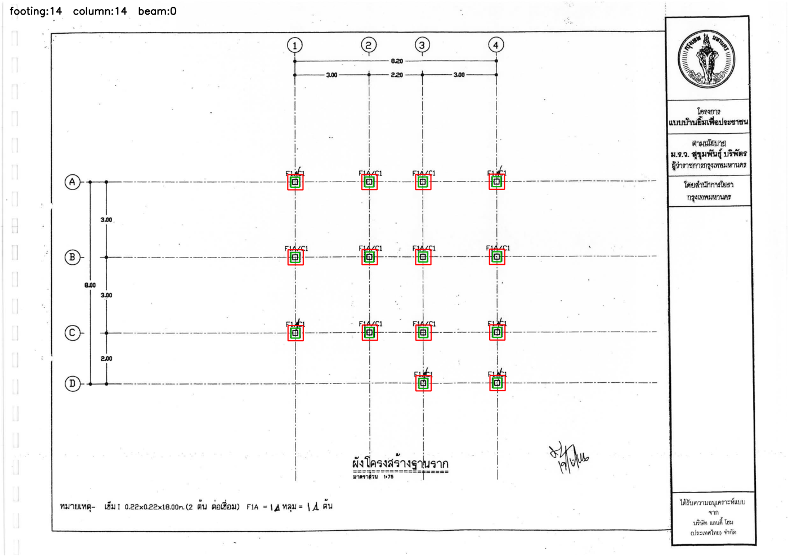
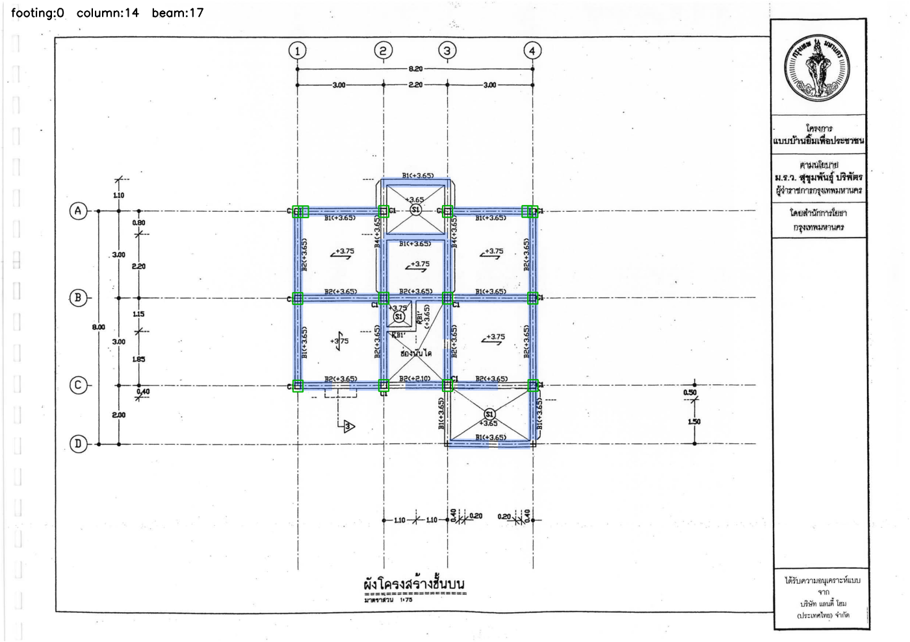
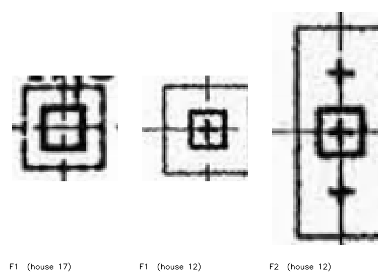
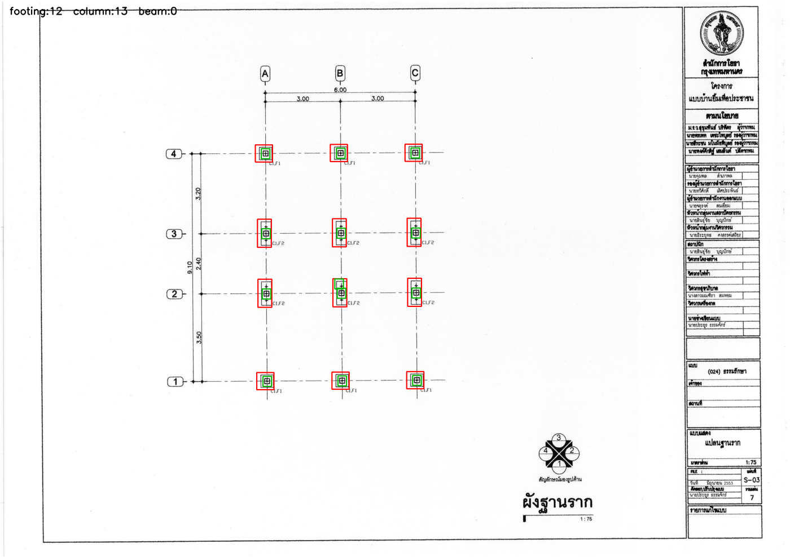

# Part 4 — The day we stopped relying on AI alone (August 25, 2026)

Continued from `2026-08-21(teach mk).md` (Part 3)
The basic terms (token, LoRA, VRAM, visual token, grammar-constrained decoding) were already explained in Parts 1-3, so here I'll just refer to them

> **The shortest possible summary before the long read:** today Makham met with the advisor and came back with 4 points; I researched all 4
> and got real results on **3 things**:
>
> 1. **Built a new tool** `tools/pattern_recognition.py` — **it marks the positions of columns/beams/footings
>    on construction-drawing images without using any AI at all** — tested: footings 14/14 and 12/12 in two houses
> 2. **Raised the image resolution the model sees by 32% without paying a single extra baht** — found that until now
>    the images in the training set **were all downscaled, 100% of them**, without anyone knowing (chapter 2.3)
> 3. **Found that "section scores 0%" is mostly not the AI's fault, but a metric that measures something impossible**
>    — even a perfect AI could score no more than 4% on the house used for evaluation (chapter 7)
>
> **The most important thing today isn't the tool, but 2 ideas:** (a) until now we tackled
> every problem by "making the AI smarter"; today is the first time we **solved it by not using AI** in the parts that
> don't need it, and (b) **before fixing a bad number, you first have to know what that number is actually measuring**

---

## 1. First, a look back — the problem from the night before that we still haven't cracked

### 1.1 t03 finished training, but it still didn't win

Last night (Aug 24-25) we finished training the 3rd round of the model; the results came out like this:

| Task (subtask) | t02 (previous round) | t03 (latest round) |
|---|---|---|
| schedule (rebar schedule) | 0% | **21.9%** ✅ improved |
| plan_slab (floor plan) | 0% | **20%** ✅ improved |
| plan_footing (foundation plan) | 33.3% | 33.3% unchanged |
| section (cross-section) | 0% | 0% unchanged |
| **plan_beam (beam plan)** | **0%** | **0%** ❌ **didn't move at all** |

The last row is the problem, because **the beam plan was the main target of the whole round**. We trained a whole new round,
spent ~$5 and 5 hours, only to find that the thing we most wanted to fix didn't move even a tiny bit

### 1.2 What is "element recall" — a term you need to understand before reading on

This term shows up throughout the document, so you need to understand it first

Suppose a beam-plan page **has 15 real beams** (this is the "answer key" a person sat down, read off the drawing and wrote down)
We have the AI read the same page; the AI answers with 3, and only 2 of them are actually correct

- **recall** = real items found ÷ all real items = 2 ÷ 15 = **13%**
- In plain words: "**what percentage of what should be found was actually found**"

**recall 0% means the AI didn't find a single one** — not that it found them but read the values wrong, but that it **didn't see them at all**

### 1.3 Why is it that bad

When we looked at what the AI actually answered, we found that on the hard beam-plan pages it wrote this:

```json
{
  "png": "20",
  "sheet_code": "S-03",
  "elements": []          ← empty
}
```

**It wrote only the page-header info and then closed the file right away, without putting in a single beam** — and worse than that,
the header info it wrote even pointed to the wrong house (it said house 22 even though it was reading house 08)
It's as if it **remembered a template from examples it had seen before and pasted it in**, without really looking at the image in front of it

This isn't a "misread the numbers" problem, it's a "**can't see that something is there**" problem
— and this is the key clue that led to today's work

---

## 2. Meeting with the advisor — 4 points, and the answer to each

Makham came back with 4 topics. I've researched all of them; let me answer them one at a time, straightforwardly.
**Knowing what doesn't work is about as valuable as knowing what does**, because it saves money and time

> **An interesting observation before you read:** the advisor's point 3 pointed at the **wrong** number (768 is a value for
> a video feature we don't use) **but that question led us to a bigger, real problem** — every image was being downscaled
> without anyone knowing. **A wrong question asked at the right spot is still worth more than an answer nobody checks**

### 2.1 Point 1 — "Make a Thai-to-English dictionary" → **it's backed by real research, but it has to be done the right way**

**What the advisor saw:** the instructions (prompt) we write for the AI are all in English, but the construction drawings themselves
are all in Thai. The advisor wondered whether this seam between the two would confuse the AI

**What I found:** there is a technique with a real academic name, called **DIP (Dictionary Insertion
Prompting)** — a 2024 research paper. The method is to **insert short translations of key terms into the instructions**, for example:

```
Terms you'll see on the drawings:
  เสา = column,  คาน = beam,  ฐานราก = footing
  เหล็กปลอก / ป. = stirrup,  ตอม่อ = pedestal
```

It's not translating the text on the drawings, but **putting a mini dictionary alongside** for the AI to look things up in

**An important warning I found in another study:** if you **translate the whole set of instructions** into English, accuracy may
**drop by ~8%**, because the source language carries context that the translation loses → so it has to be done the "insert terms" way,
not the "translate everything" way

**Status:** not done yet — waiting to ask the advisor which problem exactly they want to fix

---

### 2.2 Point 2 — "Use pattern recognition (cv2 template matching)" → **✅ done today**

This is the main content of this document — feel free to skip straight to chapter 3

---

### 2.3 Point 3 — "max_frames is 768, want to increase it" → **❌ increasing it would have no effect at all**

This one needs a bit more detailed explanation, because it's a very good case study

**The number 768 really does exist** — I found it in t03's `processor_config.json` file:

```json
"video_processor": {          ← look closely at this word
    "max_frames": 768,
    "fps": 2
}
```

**But the word `video_processor` is the key** — `max_frames` means "the maximum number of frames **of a video**"
The Qwen model accepts both still images and video; if you feed it a video, it slices the video into still images one frame at a time,
and it can slice at most 768 frames

**But we have never fed it a video, not even once** — we feed it the construction drawings one page at a time, purely still images
Our code clearly says `{"type": "image", ...}`; `"video"` never shows up anywhere

> **An analogy to picture it:** it's like our car is running slowly, and someone suggests "tune the reverse gear to be more powerful"
> — the reverse gear really exists in the car and really can be tuned, but we never use it at all when driving forward
> so tuning it gets us nowhere

**So which knob actually controls this?** There are 2, both in the file `train_t03.py`:

| Variable | Current value | What it controls |
|---|---|---|
| `MAX_PIXELS` | 5,120 × 1,024 | **Resolution per image** — how much an image gets downscaled before the AI sees it |
| `MAX_LENGTH` | 32,768 | **Total length** — how long the instructions + images + answer can be, all combined |

`MAX_PIXELS` is the one that round t01 once set wrong (images got shrunk down to 512px = very blurry images), which made
the whole round's evaluation wrong — lesson 12 in `rule_of_tune.md`

**So can we increase `MAX_LENGTH`?** In theory, yes — this model can take up to **262,144**
(we only use 32,768 = 12% of what it can handle) **but we're limited by the GPU, not by the model**
Last round we had to cut the LoRA size in half to make 32,768 fit on the 95GB GPU, and even then it was almost not enough

### 2.3.1 Once we actually measured it — we found something nobody knew before

Makham told me to keep going on this, so I wrote a measuring tool (`measure_capacity.py`) instead of guessing,
calculating directly from the image dimensions (patch 16 × merge 2 → 1 visual token = 32×32 = 1,024 pixels)

**The results were a shock:**

| Image size in the training set | Count | Tokens needed | Old cap 5,120 |
|---|---|---|---|
| 3309×2339 | 615 images | 7,558 | **loses 32%** |
| 3355×2347 | 176 images | 7,690 | **loses 33%** |
| 4631×3473 | 116 images | 15,707 | **loses 67%** |
| 3307×2339 | 65 images | 7,554 | **loses 32%** |

**973 out of 973 images in the training set = 100% were all downscaled**, not just some — even the smallest image
in the set (3307×2339) is still over the cap

We had previously recorded that "the images aren't downscaled at all", which came from measuring a single sample and generalizing from it
— **an old lesson repeating itself** (just like item 12 in `rule_of_tune.md`, which round t01 already got wrong before)

### 2.3.2 So do we need to rent a bigger GPU? — The answer is "no"

VRAM splits into 3 parts, but **only one of them grows with image resolution**:

| Part | Size | Grows with the image? |
|---|---|---|
| Model weights | 74.0 GB | ❌ constant |
| LoRA + gradient + optimizer | 5.7 GB | ❌ constant |
| **activation** | **7.8 GB** | ✅ **grows linearly** |

The first 79.7 GB doesn't budge at all → that leaves ~15 GB of free room to play with on our existing 96GB GPU

| Set to | Images still downscaled | peak VRAM | Existing 96GB GPU |
|---|---|---|---|
| 5,120 (old) | 100% | 87.5 GB | ✅ 7.5 left |
| **7,680 ← chose this one** | **30%** | **90.9 GB** | **✅ 4.0 left** |
| 16,384 (no downscaling at all) | 0% | 97.8 GB | ❌ 2.8 over |

**Actually done: changed `MAX_PIXELS` to 7,680 and `MAX_LENGTH` to 47,104**
The 615 images at 3309×2339 (the majority of the set) **will be trained at full resolution for the first time,
without paying a single extra baht**

To reach "no downscaling at all" we'd have to rent an **H200 140GB at $3.29/h = $17.45/run** (existing GPU: $5.87)
— live prices checked, but **the remaining credit is $8.91, not enough to finish even one training run; we'd need to top up first**

> ⚠️ Still something to watch: the free room shrinks from 7.5 → 4.0 GB, **so a short 5-step test run is required
> to confirm before every full run** (the previous round already hit OOM once with 470 MB left)

**Item 3 summary:** the number 768 the professor saw belongs to a video feature we don't use, **but the professor's question
led us to the real thing** — the knob that should be tuned is `MAX_PIXELS`, and it had been set unrealistically low all along
**Right question, even though the number it pointed at was wrong**

---

### 2.4 Item 4 — "Use Qwen and push the B size way up" → **❌ We're already using the biggest one we can download**

**What "B" is:** short for Billion (a thousand million) = the number of parameters; put simply, the "brain size"
The bigger, the smarter — but the more GPU it eats up

**What we're using:** `Qwen3.6-35B-A3B` = 35 billion

**How many sizes does the Qwen3.6 family offer for download?** I went and checked — there are **only 2**:

| Model | Size | Can we download it and train it ourselves? |
|---|---|---|
| Qwen3.6-27B | 27B | Yes (but smaller than the one we use) |
| **Qwen3.6-35B-A3B** | **35B** | **Yes ← this is the one we're using** |
| Qwen3.6-Max-Preview | Bigger | **No** — it's closed; usable only through the web/API |

**So we're already at the very top**; there's nothing bigger to download in this family

**What if we really jumped to a different, bigger family?** There is one — `Qwen3-VL-235B-A22B` (235 billion)
but the cost figures look like this:

| | What we're doing now | If we use 235B |
|---|---|---|
| GPUs needed | 1 GPU (96GB) | **8 GPUs (80GB each)** |
| Total memory during training | ~87GB | **~770GB** |
| Price per hour | ~$1.1 | **several times more** |
| Complexity | Run one script | Must be rewritten to spread the work across 8 GPUs |

**Item 4 summary:** this isn't "turn a number up", it's "change the scale of the entire project"
It's a budget decision, not a technical one

---

## 3. What Template Matching is — taught from scratch

Now into the main content, explained from scratch — no prior background needed

### 3.1 The principle: a "spot the difference" game the computer plays for us

Picture this:

1. You cut a small window out of paper, the size of one footing symbol — it's called a **template (แม่แบบ)**
2. You lay that window over the big construction drawing sheet, starting at the very top-left corner
3. Give it a score for "how similar is this spot to the template" — the score runs from 0 to 1
4. **Slide 1 pixel to the right** and score it again
5. Keep doing this until you've covered the whole sheet, one pixel at a time

When it's done, we get a "score map" that tells how similar every position on the drawing is to the template
Wherever the score is high = that's where the thing we're looking for is

**The command that does all of this is just one line:**

```python
คะแนน = cv2.matchTemplate(ภาพใหญ่, แม่แบบ, cv2.TM_CCOEFF_NORMED)
```

`cv2` is the name of the OpenCV library — an image-processing tool used all over the world for 20 years, and it's free

### 3.2 Why it's so fast (and needs no GPU)

One page of our drawings is 3309 × 2339 pixels = **7.7 million positions** to lay the template over and score
That sounds like a lot, but the machine finishes in **under 1 second** on an ordinary CPU

Because it's only multiply-and-add arithmetic with no "thinking" at all — unlike AI, which has to compute through
a neural network of several billion parameters

> **This is why this tool is valuable:** it's free, fast, and **gives the same result every time**
> Run it ten times and you get exactly the same answer — unlike AI, which doesn't give the same answer twice

### 3.3 6 scoring methods — and why we chose this one

OpenCV lets you choose from 6 formulas for scoring similarity:

| Formula | How to read the result |
|---|---|
| `TM_SQDIFF`, `TM_SQDIFF_NORMED` | **the lower, the more similar** (measures difference) |
| `TM_CCORR`, `TM_CCORR_NORMED` | the higher, the more similar |
| `TM_CCOEFF`, **`TM_CCOEFF_NORMED`** | the higher, the more similar ← **we use this one** |

**Why we chose `TM_CCOEFF_NORMED`:**

- The word **`NORMED`** (normalized = adjusted to a standard scale) means the score always stays in the range **0 to 1**,
  which lets us set a threshold, e.g. "keep only those above 0.6". Without normalizing, the score would be some
  who-knows-what number and no threshold could be set
- The word **`CCOEFF`** (correlation coefficient) is the formula that **subtracts the average brightness before comparing**
  This matters a lot for our work, because the drawings are **scanned** images — some pages scan out greyish, some come out very white
  This formula looks at the "pattern", not the "brightness" → even a page that scanned dark can still be detected

### 3.4 threshold (cutoff) — the knob you have to turn yourself

Once we have the score map, we have to say "how high does a score have to be to count as a find" — that's the **threshold**

- **Set too high (e.g. 0.95)** → few finds, lots of real ones slip through
- **Set too low (e.g. 0.3)** → lots of finds, but it also grabs text/table borders

The values we actually use (found by actually trying, not guessed):

| Type | Threshold | Reason |
|---|---|---|
| Footing | 0.60 | Very distinctive shape — setting anywhere from 0.5-0.8 gives the same 14/14 |
| Column | 0.65 | Small shape — needs to be a bit stricter, otherwise it makes false hits |
| Beam | 0.70 | Plain lines that look like lots of other lines — needs to be the strictest |

### 3.5 NMS — the problem everyone runs into, and how to fix it

**Problem:** if a footing sits at coordinates (1240, 766) and we slide the template to (1241, 766) — moving it
just 1 pixel — it **still matches** and the score is still high

So 1 footing produces high-scoring points **by the hundreds**, clustered around each other
In reality we have 14 footings, but the system reports **235 points**

**The fix is called NMS (Non-Maximum Suppression)** — literally "suppressing the ones that aren't the maximum"
The idea is very simple:

1. Sort all the points from the highest score down
2. Take the highest-scoring point and keep it = "this one is definitely real"
3. **Delete every point close to that point** (closer than half the template's size) — because it's the same object
4. Take the next one that's still left, loop back to step 2

**Our actual result:** 235 points → NMS → **14 points**, an exact match with reality

### 3.6 Limitations to know from the start

The research I read (SkeySpot, 2025 — work on detecting symbols on electrical drawings) says it clearly:

**Template matching breaks when:**

1. **The symbol is rotated** — if the template is vertical but the real one is tilted 30 degrees, it won't catch it at all
2. **The symbol is a different size** — a 56px template against a real 40px one doesn't match either
3. **The symbol is drawn differently** — different design offices draw it differently

**We actually ran into both #2 and #3 today** (told in chapter 5)
The research recommends Deep Learning (YOLO) instead — but YOLO needs someone to sit and **draw boxes to train it**
on thousands of images first, which we don't have time for, so template matching is the better-value route for now

---

## 4. What we built today — walking through it part by part

### 4.1 What the tool looks like

File: `tools/pattern_recognition.py`

```
python tools/pattern_recognition.py "image/บ้าน_เล็ก_2ชั้น_17/..._หน้า14.png"
```

You get a new image out at `tools/pattern_out/..._หน้า14_marked.png` that looks like this:

- **Red box** = footing
- **Green box** = column
- **Translucent blue band** = beam
- The top-left corner shows the counts for you



*House 17 foundation plan — all 14 footings (red boxes) match reality, no false hits outside the plan*



*House 17 upper-floor beam plan — the blue bands cover the beam framing, the green boxes are the columns at the intersections, and there are no red boxes at all (correct, because a beam plan has no footings)*

### 4.2 Where the templates come from — cropped from real drawings

The 4 templates are kept in `tools/templates/`, and every one of them is **cropped from a real drawing image**, not drawn by us:

| File | What it is | Cropped from |
|---|---|---|
| `tpl_footing.png` | F1A footing icon (nested squares) | House 17, page 14 |
| `tpl_footing2.png` | F2 footing icon (rectangle + 2 pile dots) | House 12, page 20 |
| `tpl_footing3.png` | House 12's F1 footing icon | House 12, page 20 |
| `tpl_column.png` | C1 column box | House 17, page 16 |

### 4.3 Beams are special — not cropped from an image, but **drawn by us**

Beams are the exception, because **beams have no fixed size** — a short-span beam is 300px long, a long-span beam 900px long
so you can't crop one into a template, because you wouldn't know how long to crop it

**What stays constant is its "cross-section"** — on a plan, a beam is drawn as **2 parallel black lines**
(the beam's two edges), so we drew the template ourselves like this:

```python
def beam_template(gap=21, thick=3, length=60):
    tpl = all white, size (33 × 60)
    tpl[6:9,   :] = black   # top edge line of the beam
    tpl[27:30, :] = black   # bottom edge line of the beam
    return tpl
```

The number `gap=21` (a 21-pixel spacing) **wasn't guessed** — I measured it on a real image and found the beam's top edge
sits at rows y=758-760 and the bottom edge at y=777-779 → 21 pixels apart

Then: search for this short template across the whole page → you get points strung out along long lines → **join adjacent points into a single band**
→ throw away bands shorter than 100 pixels (so it doesn't catch text)

> **⚠️ A caveat already noted in the code:** this number 21 is tied to this set's scan resolution
> (3309×2339, scale 1:75) — if you come across a house scanned at a different resolution, you have to adjust it yourself
> with the `--beam-gap` option

### 4.4 Real results — every image checked by eye

| Page | Footings | Columns | Beams | What the check found |
|---|---|---|---|---|
| House 17 foundation plan | **14/14** ✅ | 14 | 0 | Not a single false hit |
| House 17 upper-floor beam plan | 0 ✅ | 14 | 17 bands | The blue bands cover almost all of the beam framing |
| House 12 foundation plan | **12/12** ✅ | 13 | 0 | Catches both F1 and F2 |
| House 12 second-floor beam plan | 0 ✅ | 13 | 19 bands | — |

Notice the "Footings" column on the beam-plan pages = **0** — that's correct, because a beam plan has no footings
If it showed any other number, that would mean false hits (and at first it really did make false hits — read chapter 5)

---

## 5. The 2 bugs found today — and how to think when fixing them

This part matters more than the tool itself, because it's a way of thinking you can reuse on every job

### 5.1 Bug 1 — F1 and F2 don't differ just in "size", they differ in "shape"

**Symptom:** when we tried house 12 (the 2nd house), the system found only **6 of 12** footings

**My first hypothesis (wrong):** "it's probably because this house draws the icons at a different size"
So I added **multi-scale**, i.e. shrinking/enlarging the template to 6 sizes (0.7, 0.8, 0.9, 1.0, 1.1, 1.2×)
and searching at every size

**Result: still 6, same as before** → the hypothesis was wrong

**So I went and actually opened the image** — cropped the two icons out to look at side by side, and saw it right away:

| | F1 | F2 |
|---|---|---|
| Shape | Nested **squares** | Vertical **rectangle** |
| Inside | 1 cross | 1 cross + **2 pile dots, top and bottom** |



*The actual templates used — left/middle are F1 from the two houses (nested squares), right is F2 (rectangle + pile dots top and bottom)*

**They're two different things, not the same thing at different sizes** — F1 is a 1-pile footing,
F2 is a 2-pile footing; they differ by design, not by how they're drawn

**The fix: a template bank (a library of templates)** — instead of having a single template, keep several kinds in a folder
and search for every one of them, then merge the results and run NMS once

```python
def load_templates():
    # read every file whose name starts with tpl_footing
    for p in sorted(TEMPLATE_DIR.glob("tpl_footing*.png")):
        ...
```

The upside is that **if we hit a house that draws its footings a new way, we just crop the image and add it to the folder — no code changes at all**

**Result after the fix: 12/12** ✅



*House 12 after adding the template bank — catches both F1 (top/bottom rows) and F2 (middle row), all 12 of them; notice that F2's red boxes are taller, because the icon is a different shape*

> **Lesson:** a first hypothesis that sounds reasonable (different sizes) can be wrong
> The right way to prove it is to **open the real thing and look with your own eyes**, not keep guessing and write more code
> — this is the same lesson as rule 14 in `rule_of_tune.md`

### 5.2 Bug 2 — footings showing up on the beam plan, even though a beam plan has no footings

**Symptom:** once the F2 template (vertical rectangle) was put into use, it turned out that on house 12's **beam plan**
it drew 3 red boxes — even though a beam plan has no footings in the first place

**Cause:** picture **a vertical beam running through a column box** — it forms the shape of "a vertical rectangle
with something in the middle", which **looks a lot like F2**. The computer only sees shapes, so it can't tell them apart

**The fix I first had in mind (not good):** make the threshold stricter
→ but that would also make the real F2s on the foundation plan drop out = moving the problem, not fixing it

**The fix actually used — bring in knowledge of construction drawings to help:**

> **On a real foundation plan, there are no beams to detect at all** (because the two are plans of different levels)
> So: **if a spot we think is a footing turns out to sit inside a detected beam strip → drop it**

```python
# drop footings whose center point falls inside a beam strip
out["footing"] = [f for f in out["footing"]
                  if not any(in_beam_strip(f, strip) for strip in beams)]
```

**Why this rule is 100% safe:** because on a real foundation plan, the beams the system detects = 0 strips
so this rule has no way of ever dropping a real footing (there's no strip for it to fall into)

**Result after the fix: the beam plan gets 0 footings** ✅ and **the foundation plan still gets 12/12, same as before** ✅

> **Lesson:** sometimes the best fix isn't tuning numbers but **putting knowledge of the real work**
> in as a rule — the knowledge that "a foundation plan has no beams" is an engineer's knowledge, not a programmer's

---

## 6. So how does this tool help with recall?

Back to the original problem: the AI can't see the 15 beams on a single page

### 6.1 What this tool can / can't do

| | template matching | AI (Qwen) |
|---|---|---|
| Say "there's a column here" | ✅ can | ✅ can (but often misses) |
| Say "this column is named C1 or C2" | ❌ can't | ✅ can |
| Give the rebar size/count | ❌ can't | ✅ can |
| Give the same result every time | ✅ yes | ❌ no |
| Cost | free | ~$1.1/h |

**These two aren't competing; they complement each other** — this tool is good at "finding what is where",
the AI is good at "reading what it is"

### 6.2 Ways to put it to use — 3 options, ordered from safe to risky

**(a) As a helper for the person checking the work** — while Makham sits correcting rawjson, open the marked image and look at it side by side
and you'll see right away where there are beams that haven't been recorded yet. **Doesn't touch any system at all — the safest**

**(b) As a check on whether the AI missed anything** — running the tool gives 15 beam strips, but the AI answers with 3
→ the system immediately warns "this page probably missed something", so we know we need to re-run it. **Doesn't touch the training data — safe**

**(c) Feed the positions to the AI before it reads** — tell the AI in advance, "this page has beams at these coordinates;
go read their names" — this has the strongest effect, **but it's a change to the training data = it falls under `rule_of_tune`
rule 2, which always requires a warning and asking permission first — so it wasn't done today**

---

## 7. And what about section, which got 0% — can pattern recognition be used?

Makham then asked whether today's tool could be used to help with section. I started trying it right away **and then caught myself
doing things in the wrong order** — I was looking for a fix without having diagnosed why it was 0%, so I backed up to diagnose first
**and the answer turned into a completely different story**

### 7.1 A lesson in how to think: there are 2 kinds of "bad numbers", and you have to tell them apart

- **Type A — the model genuinely can't do it** → fix it in the model/prompt/helper tools
- **Type B — the metric measures something impossible** → even a perfect model would still get 0
  no matter how much you fix the model, the number won't budge

**If you can't tell them apart and guess wrong = you waste a whole training round's money fixing something that isn't the problem**

### 7.2 Going to look at how "0%" is actually counted

The evaluation code uses this line:

```python
hit = len(set(gt_ids) & set(pred_ids))    # exact string match
```

Then I went and opened up what the `element_id` values in the section ground truth really look like:

```
gate_front · door_lock_detail · SP_at_bathroom · purlin_rafter_connection
FCO_detail · SP_unsupported_beam_edge · ห้องนอน · ระดับพื้นอาคาร
```

**These names aren't printed on the drawings** — they're names that **the annotator made up** to tell sub-details apart
There's no way the AI (or a person) could guess `SP_at_edge_beam` from looking at the image, because not a single letter of that text
appears anywhere on the paper

> **Analogy:** it's like showing a kid a picture of a dog and asking "what's this dog's name?" — the answer is "Bobby",
> which the owner made up. No matter how good the kid's eyesight is, they can't answer — and that's not the kid's fault

### 7.3 Putting a number on it — the "ceiling" of each task

I wrote a tool, `measure_id_ceiling.py`, that separates the 2 kinds of names and counts them:

| Task | Total names | Actually readable from the drawings | **Max ceiling** | t03 achieved | Meaning |
|---|---|---|---|---|---|
| plan_beam | 2,484 | 2,175 | **88%** | 0% | 🔴 **the model is genuinely broken** |
| plan_slab | 283 | 261 | 92% | 20% | 🔴 the model is genuinely broken |
| plan_footing | 462 | 345 | 75% | 33% | 🟡 some room to improve |
| schedule | 662 | 403 | 61% | 22% | 🟡 some room to improve |
| **section** | 2,436 | 902 | **37%** | 0% | 🟠 **the metric is half broken** |
| notes | 272 | 5 | 2% | – | 🟠 the metric is almost completely broken |

**And for house 08 alone — the house actually used for evaluation — the section ceiling = 1 out of 23 = 4%**
because house 08 is a single-storey house whose section pages are almost all **fence/door/water-pipe** details,
not beam-column cross-sections → **even a perfect AI couldn't get more than 4%**

### 7.4 Conclusion — these two 0%s are two different diseases

| | plan_beam 0% | section 0% |
|---|---|---|
| Ceiling | 88% | **4%** (the house we measure on) |
| Meaning | The model genuinely can't read it | The metric is measuring something impossible |
| Can pattern recognition help? | **✅ Yes, this is the right target** | ❌ No, there's nothing on the paper to detect |

**If you lump these two together and conclude "the model is bad at reading" = wrong conclusion**
plan_beam has to be fixed in the model, while section needs its metric fixed first — otherwise next round we'll have no way of knowing
whether what we did actually worked

### 7.5 Actually tried before concluding — recorded so nobody else repeats it

I didn't just conclude out of thin air — I tried 3 methods first:

| Method | House 17 | House 12 | House 01 |
|---|---|---|---|
| Find the circles enclosing the names (B1)(B2) with HoughCircles | **5/5 ✅ not a single false hit** | 3/20 ❌ | 0/18 ❌ |

Worked beautifully on house 17 but **failed completely on the other 2 houses**, because **each design office's section pages
are drawn differently** — house 17 circles the names, house 01 prints "B1 1:20" underlined with no circle at all
Unlike the structural plans (column/beam/footing), whose symbols are much more consistent — and that's why
today's tool works on structural plans but not on section

### 7.6 Proposed fixes (not done yet, because touching the ground truth = need permission first)

1. **Split the metric's columns** — report the score for names printed on the drawing separately from names people made up themselves
   *(only changes the scoring script, doesn't touch the ground truth = safest, can be done right away if ordered)*
2. **Strip spaces / normalize upper-lower case before comparing** — so `"B1 "` no longer fails to match `"B1"`
3. Change the naming convention for section `element_id` (touches the ground truth = a big job, needs permission)

---

## 8. What we don't know yet / haven't done yet (must be said plainly)

Per this project's rules, I have to list in full what is **not yet proven**:

1. **Tested on only 2 houses, both from the same series** (the Bangkok Metropolitan Administration's แบบบ้านยิ้มเพื่อประชาชน ("Smile House for the People") design series)
   Houses from other design offices may draw the symbols completely differently — **we don't know yet whether it will break**

2. **Never tried on pages that aren't structural plans** — cover pages, sections, BOQ tables
   If it puts bogus marks on those pages, whoever uses it will be misled — **this should be tested before real use**

3. **There's a minor duplicate** — house 12's foundation plan shows 13 columns when there are 12 (one spot has overlapping boxes)
   Not fixed, because it barely affects the overall picture

4. **Slabs (S1) not done yet** — Makham scoped it to column/beam/footing only, so I stopped there

5. **Not connected to anything at all yet** — it's a standalone tool that only outputs images
   Doesn't touch the rawjson, doesn't touch the prompt, doesn't touch the training data

---

## 9. Today's vocabulary

| Term | Plain meaning |
|---|---|
| **template** | Master pattern — the small image we lay over the big image to search with |
| **template matching** | Sliding the template over the whole big image and scoring how similar each spot is |
| **threshold** | Cutoff — the minimum score that counts as "found" |
| **NMS** | Removing overlapping points so only 1 representative point is left per object |
| **multi-scale** | Searching at several sizes — shrink/enlarge the template and search at every size |
| **false positive** | A bogus hit — says it found something when nothing is actually there |
| **recall** | What % of the things it should find it actually finds |
| **CPU / GPU** | CPU = an ordinary computer's brain (this job only needs this) / GPU = graphics card (has to be rented, expensive) |
| **B (in a model's name)** | Billion parameters = the size of the AI's brain |
| **max_frames** | Maximum number of frames of a **video** (we don't use it) |
| **MAX_LENGTH** | Total length the AI can take in per call (this one we really use) |

---

## 10. Try it yourself — all the commands

Open a terminal in the `Training` folder and type:

```bash
# 1. Test that the tool works correctly (it checks whether it really gets 14 footings)
python tools/pattern_recognition.py --demo

# 2. Run it on any page
python tools/pattern_recognition.py "image/บ้าน_เล็ก_2ชั้น_17/บ้าน_เล็ก_2ชั้น_17_หน้า14.png"

# 3. If you hit a house scanned at a different resolution and the beams aren't detected, try adjusting the gap between the beam edges
python tools/pattern_recognition.py "ภาพ.png" --beam-gap 30
```

The output images are in **`tools/pattern_out/`** — open them up and take a look

**If you hit a house that draws its footings differently**, here's how to add a template yourself:

1. Open the image and crop out just 1 footing icon (leave a little margin around it)
2. Save it as `tools/templates/tpl_footing4.png` (the next number after the existing ones)
3. Run it again — the program picks up the new file automatically, no code changes needed

---

## 11. The shortest possible summary

1. **t03 improved on several things, but the beam plan is still 0%** — the problem is the AI can't see the objects, not that it reads them wrong
2. **Item 2 (pattern recognition) was finished today** — it really marks columns/beams/footings
   Free, fast, no GPU, no AI
3. **Item 3 (max_frames) pointed at the wrong number, but led us to the real problem** — the training-set images were downscaled, **every single one, 100%**
   Fixed — gained **32% more resolution without paying anything extra** (no need to rent a bigger GPU as we first thought)
4. **Item 4 (increase the B size) won't work** — we're already on the largest one we can download and train ourselves
5. **Item 1 (dictionary) really does have research behind it**, but it has to be done as "insert the vocabulary", not "translate the whole set"
   — not done yet, waiting to talk with the professor
6. **section 0% is not the AI's fault** — the metric uses names that people made up themselves (`gate_front`, `SP_at_bathroom`)
   which don't exist on the paper. **The ceiling for the house used for evaluation is 4%**. Fix the metric first, not the model
7. **2 new ideas gained:** (a) not every problem has to be solved by making the AI smarter
   some things plain math does better, cheaper, and more reliably
   (b) **before fixing a bad number, first know what that number measures** — otherwise you might waste a whole round's money
   fixing something that isn't the problem

---

## 12. Appendix — trying to find an AI model other than Qwen

That same night, Makham ordered a search for 100-200B vision models that are **not from the Qwen family**
(neither by brand name nor by the "brain" inside) to compare against — 8 models checked

### 12.1 The one that's good but can't be used — Pixtral-Large

- **Size ~124B** (Mistral AI) — good at **reading documents/tables/charts** and supports very long text
- **Has a pixel-counting system** like the Qwen we're using — it doesn't force images to be shrunk into a fixed square
  but cuts them into patches according to the image's real size (different sizes/aspect ratios use different numbers of patches)
- **But it can't be used at all** — the license is the **Mistral Research License**, which bans commercial use
  unless you buy a separate license from Mistral. **No matter how good it is, it's eliminated on this one point alone**

### 12.2 Why the others were eliminated too

| Model | Eliminated because |
|---|---|
| InternVL3-78B / InternVL3.5-241B | A different brand, but inside it uses Qwen2.5/Qwen3 as its brain — still counts as Qwen |
| GLM-4.6V | License is OK, but it has a bug that makes LoRA training impossible (nobody has fixed it yet) |
| Molmo-72B, NVLM-D-72B | No training tool has confirmed yet that they actually work |

**Only 2 survived:** GLM-4.6V (stuck on the bug) and **Llama-4-Scout** (Meta, free to use if <700 million users/month,
actually trainable) — but for both, **nobody has tested yet how well they read Thai**

### 12.3 Update — re-checking the 2 models still left pending

- **NVLM-D-72B (NVIDIA)** — truly ruled out: the license is **CC-BY-NC-4.0, flatly no commercial use**
  so it was off-limits for STECON from the start, no need to even talk about the framework — and vLLM itself can't run it yet either
  (NVIDIA admitted this themselves in an HF thread)
- **ERNIE-4.5-VL-28B-A3B (Baidu)** — correcting earlier info: it actually **has an Unsloth notebook that works right away**
  (previously misunderstood as needing ERNIEKit only) but this one is only **28B**, smaller than the requested 122B±50 criterion
- **Also found:** OmniDocBench (a real-results leaderboard that is still maintained) has **InternVL3-78B scoring 83.76
  points**, the only one of all 10 models checked that actually appears on the leaderboard — this adds a little credibility
  to InternVL3-78B (although it would still need a framework switch from Unsloth to LLaMA-Factory
  and it still counts as a Qwen backbone anyway)

### 12.4 Continuing the hunt for an NVLM-D-72B substitute — no exact replacement found yet

Makham liked NVLM-D-72B (even though it was eliminated), so asked me to keep looking for anything similar — found 3 new ones
but **none of them can replace it to spec yet** (72B + commercial + easy to train):

| Model | Size | License | Summary |
|---|---|---|---|
| **Nemotron 3 Nano Omni** (NVIDIA, Apr 2026) | 30B (active 3B) | **actually usable commercially** ✅ | NVLM's spiritual successor, but **much smaller than requested**; the cleanest license of everything checked so far |
| GLM-5V-Turbo (Z.ai, Apr 2026) | Not disclosed | Closed — API only | **Can't be downloaded to train ourselves at all**, eliminated immediately |
| MiniMax M3 | 428B total / 22B active | Has nested conditions | Free if non-commercial, but fine-tuning it for real use counts as commercial and needs a separate license — similar to Pixtral-Large's trap; **not 100% ruled out yet, need to read the terms more carefully** |

**Overall summary of section 12:** the field right now is split into 2 camps — **the truly open camp** (Qwen/DeepSeek/Gemma)
which has almost no mid-size vision models at all, and **the camp that's good at vision** (Mistral/MiniMax/NVIDIA)
but almost every one of them ties its license to hidden conditions. Haven't found one that has all 3 yet (size + clean license + actually trainable)

---

*This document was written on August 25, 2026 — the detailed work log is in `2026-08-25.md`
and the actual code is in `tools/pattern_recognition.py`*
